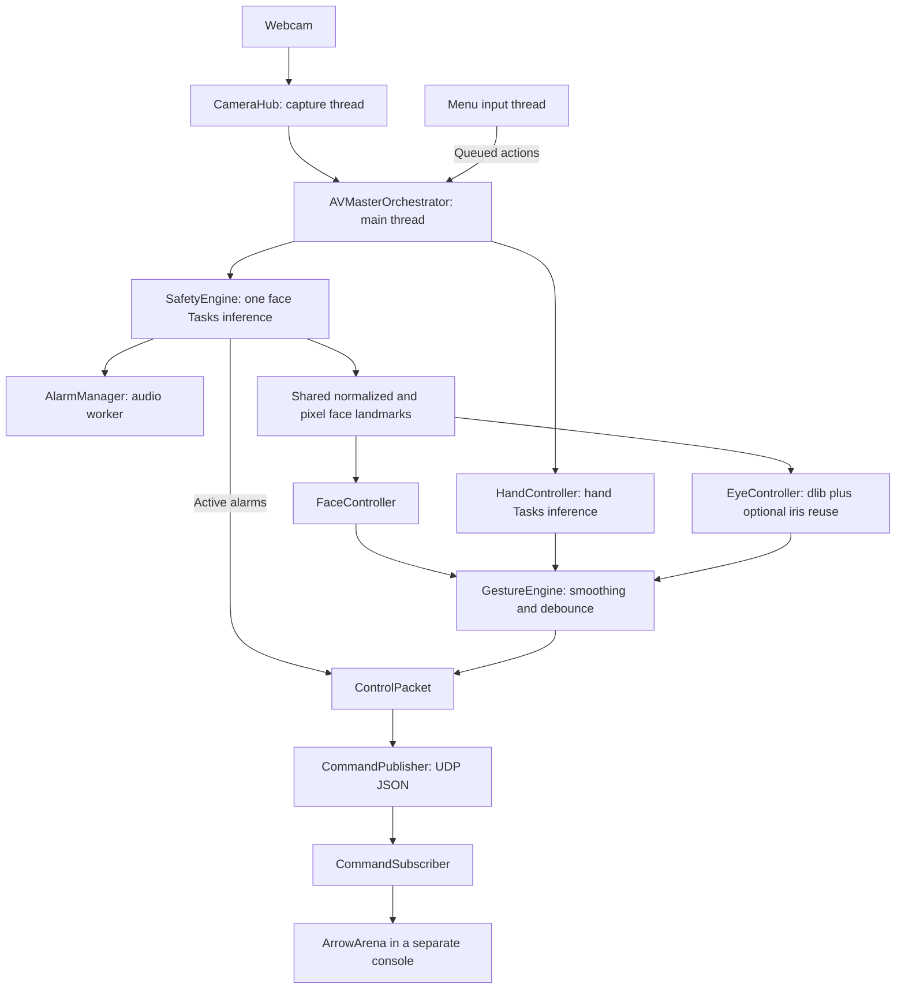

# Manual Mode: Landmark Control and Driver Monitoring

Manual Mode is a Python computer vision project that turns face, hand, and eye movements into directional commands and demonstrates those commands in a local terminal simulator. A driver monitoring system (DMS) measures eye closure, mouth opening, and sideways gaze while any control mode is active, including standby.

The main application is [av_master.py](av_master.py). It combines a shared webcam, MediaPipe Tasks, dlib, gesture filtering, asynchronous Windows alarms, and a nonblocking UDP connection. The repository also contains independent face landmark, hand tracking, drowsiness, traffic light, and traffic sign demos.

This README describes the source and configuration present on **24 November 2026**. It includes implementation details and known inconsistencies. Application execution, model inference, camera behavior, audio, and test results were not verified during this documentation review.

## Contents

1. [Features and current scope](#1-features-and-current-scope)
2. [Project layout](#2-project-layout)
3. [Requirements and installation](#3-requirements-and-installation)
4. [Models and other assets](#4-models-and-other-assets)
5. [Running the main application](#5-running-the-main-application)
6. [Architecture and lifecycle](#6-architecture-and-lifecycle)
7. [Configuration and data interfaces](#7-configuration-and-data-interfaces)
8. [Driver monitoring implementation](#8-driver-monitoring-implementation)
9. [Controllers and gesture implementation](#9-controllers-and-gesture-implementation)
10. [UDP transport and arrow simulator](#10-udp-transport-and-arrow-simulator)
11. [Standalone landmark and monitoring demos](#11-standalone-landmark-and-monitoring-demos)
12. [Road detection demos](#12-road-detection-demos)
13. [Preflight and lighting calibration](#13-preflight-and-lighting-calibration)
14. [Tests and benchmark](#14-tests-and-benchmark)
15. [Generated data and recordings](#15-generated-data-and-recordings)
16. [Known issues and troubleshooting](#16-known-issues-and-troubleshooting)
17. [Extending the project and references](#17-extending-the-project-and-references)

## 1. Features and current scope

| Component | Implemented behavior |
| --- | --- |
| Face control | Reuses the safety engine's 478 landmarks; maps normalized nose offsets to LEFT, RIGHT, UP, DOWN, or STOP. |
| Hand control | Runs a 21-point hand model; steers using the index fingertip's position. A fist or curled index requests STOP. |
| Eye control | Uses dlib eyelids and pupil estimates, with shared MediaPipe iris coordinates preferred when available. Closed eyes request STOP. |
| Gesture filtering | Exponential moving averages, configurable dead zones, dominant-axis selection, consecutive-frame debounce, and tracking-loss STOP. |
| Neutral calibration | The main application's `c` key sets a neutral center for the selected face, hand, or eye mode. |
| Driver monitoring | Detects sustained low EAR, high MAR, and sideways iris gaze using elapsed-time thresholds. |
| Alarms | Displays all active alarms, includes them in control packets, and plays the highest-priority Windows notification on a worker thread. |
| IPC | Sends compact JSON over IPv4 UDP, normally to `127.0.0.1:5055`. |
| Simulator | Moves an ASCII arrow in a bounded arena, displays telemetry, and stops movement when packets become stale. |
| Standalone demos | Five-point and 68-point dlib faces, 468/478-point face mesh, hand tracking, and dlib drowsiness monitoring. |
| Road perception | Separate Haar/HSV traffic light, brightness/position traffic light, circular sign, STOP sign, and arrow symbol detectors. |
| Verification tools | Six phase scripts, legacy monitoring tests, hand self-tests, color detector tests, preflight, and a synthetic integration benchmark. |

The implemented command destination is the arrow simulator. Vehicle actuation, autonomous navigation, sensor fusion, and a running ROS 2 integration are not present. ROS 2 examples in some module docstrings describe possible future wrappers.

The road detectors run independently. Their results do not enter the main controller, the safety engine, or its UDP packets.

Safety alarms are notifications and packet metadata. They do **not** automatically replace a movement command with STOP. Eye closure, a fist, a curled index, neutral gestures, tracking loss, mode transitions, and shutdown have separate STOP behavior described below.

## 2. Project layout

The following tree covers the project's own source, documentation, configuration, models, and sample outputs. Installed third-party packages and caches are omitted.

```text
manual-mode/
├── README.md
├── av_master.py                     Main application and mode orchestration
├── camera_hub.py                    Shared capture producer and frame packets
├── contracts.py                     Enums, status/packet types, JSON config loader
├── safety_engine.py                 Current elapsed-time DMS and AlarmManager
├── gesture_mapper.py                Gesture rules, smoothing, debounce, calibration
├── ipc_bus.py                       Nonblocking UDP publisher and subscriber
├── arrow_game.py                    Terminal simulator and console launcher
├── project_config.json              Main application's settings
├── controllers/
│   ├── __init__.py                  Controller factory and exports
│   ├── base.py                      Common ControllerOutput and BaseController
│   ├── face_controller.py           Shared face landmark features
│   ├── hand_controller.py           Single-hand Tasks features
│   └── eye_controller.py            dlib eyelids, pupils, shared iris features
├── calibrate_demo.py                Preflight and optional live DMS calibration
├── run_all_tests.py                 Regression runner and integration benchmark
├── test_phase1_infra.py             CameraHub and UDP checks
├── test_phase2_safety.py            Current safety geometry, timers, alarms
├── test_phase3_controllers.py       Controller geometry, ownership, lifecycle
├── test_phase4_game.py              Arena, watchdog, rendering, UDP, launcher
├── test_phase5_gestures.py          Gesture rules and command integration
├── test_phase6_master.py            Main orchestration checks
├── master_controller.py             Earlier safety-only application
├── safety_daemon.py                 Earlier frame-count-based DMS
├── test_safety_daemon.py            Legacy DMS and master unittest suite
├── detect_facemesh.py               Standalone 468/478-point face mesh
├── eye_tracker.py                   Standalone DrowsinessDetector and webcam demo
├── hand_tracker.py                  Standalone HandDetector, geometry, webcam demo
├── selftest.py                      Standalone hand correctness checks
├── requirements-facemesh.txt        Pinned current MediaPipe/OpenCV/NumPy profile
├── requirements.txt                Pinned standalone dlib face profile
├── eye_requirements.txt            Standalone dlib eye/SciPy profile
├── hand_requirements.txt           Older standalone MediaPipe hand profile
├── face_landmarker.task
├── hand_landmarker.task
├── shape_predictor_5_face_landmarks.dat
├── shape_predictor_68_face_landmarks.dat
├── shape_predictor_68_face_landmarks.dat.bz2
├── face-landmark-project/
│   ├── README.md
│   ├── detect_5point.py
│   ├── detect_68point.py
│   ├── detect_facemesh.py
│   ├── requirements.txt
│   ├── requirements-facemesh.txt
│   ├── face_landmarker.task
│   ├── shape_predictor_5_face_landmarks.dat
│   ├── shape_predictor_68_face_landmarks.dat
│   ├── shape_predictor_68_face_landmarks.dat.bz2
│   ├── LANDMARKS_JSON               Existing 68-point JSON Lines data
│   ├── lm.jsonl                     Existing 478-point JSON Lines data
│   ├── out.mp4
│   ├── output.mp4
│   ├── test1.mp4
│   └── test2.mp4
├── road-detection/
│   ├── traffic-light-detection/
│   │   ├── by-color/
│   │   │   ├── traffic_light_detector.py
│   │   │   ├── traffic_light_cascade.xml
│   │   │   ├── traffic_light_cascade.LICENSE.txt
│   │   │   ├── test_traffic_light_detector.py
│   │   │   ├── requirements.txt
│   │   │   └── EXECUTION_GUIDE.md
│   │   └── by-position/
│   │       ├── traffic_light_position.py
│   │       ├── traffic_light_cascade.xml
│   │       ├── requirements.txt
│   │       └── README.md
│   └── traffic-sign-detection/
│       ├── traffic_sign_circles.py
│       └── traffic_sign_arrows.py
├── DEMO_RUNBOOK.md                  Compact demo instructions; see known issues
├── PHASE0_AUDIT.md                  Historical initial workspace audit
└── .gitignore
```

The reviewed workspace also contains `.venv/`, `manual_venv/`, and separate `traffic_venv/` and `position_venv/` directories beneath the traffic light demos. These are installation artifacts with machine-specific interpreter paths.

The root and nested `detect_facemesh.py` files are byte-identical. Corresponding face model, dlib predictor, and compressed 68-point predictor copies are also byte-identical. The two traffic light XML files are different models.

Large dlib predictors and videos exist in the reviewed workspace but match `.gitignore` rules. Their presence in a fresh checkout is not guaranteed.

## 3. Requirements and installation

### 3.1 Main application environment

Use **64-bit Python 3.11** for the documented setup. The local environments identify Python **3.11.9**. The initial hardware target recorded in [PHASE0_AUDIT.md](PHASE0_AUDIT.md) was Windows 11, an 11th-generation Intel Core i5, 8 GB RAM, and one built-in webcam; this is a target description, not a performance guarantee.

The main application needs:

| Dependency | Purpose |
| --- | --- |
| `mediapipe` | Tasks FaceLandmarker and HandLandmarker inference. |
| `numpy` | Image arrays, landmark conversion, distances, projections, masks. |
| `opencv-contrib-python` | Provides `cv2` for capture, color conversion, geometry, drawing, desktop windows. |
| `dlib` | Required when selecting EYE mode and by controller/model verification scripts. |
| Python standard library | Threading, queues, sockets, JSON, subprocesses, timing, filesystem handling, Windows console/audio APIs. |

The root [requirements-facemesh.txt](requirements-facemesh.txt) pins:

```text
mediapipe==1.2.3
numpy==2.4.6
opencv-contrib-python==5.1.0.95
```

It **does not list dlib**. The reviewed `manual_venv` package metadata contains `dlib==19.24.9`, which is also the version recorded in the initial audit. The unified `EyeController` does not need SciPy.

From the repository root, create a fresh environment and install the main profile:

```powershell
py -3.11 -m venv .venv
.\.venv\Scripts\python.exe -m pip install --upgrade pip
.\.venv\Scripts\python.exe -m pip install -r requirements-facemesh.txt
```

For EYE mode and the complete controller verification tools, additionally install dlib:

```powershell
.\.venv\Scripts\python.exe -m pip install dlib==19.24.9
```

A Windows dlib source build can require CMake and Visual Studio Build Tools with the **Desktop development with C++** workload and Windows SDK. The standalone eye requirements document these prerequisites. Installation was not attempted during this README review.

If the existing `manual_venv` is already usable, run its interpreter directly:

```powershell
.\manual_venv\Scripts\python.exe av_master.py --mode face
```

Direct interpreter paths avoid shell activation ambiguity. If you prefer activation:

```powershell
.\.venv\Scripts\Activate.ps1
python av_master.py --mode face
```

Use a desktop OpenCV distribution for GUI demos. Keep one OpenCV distribution per environment: `opencv-python`, `opencv-contrib-python`, and their headless variants all install the same `cv2` namespace.

### 3.2 Other dependency profiles

The requirement files describe different setups. They should be installed into the environment for the corresponding program.

| File | Declared dependencies | Intended use |
| --- | --- | --- |
| Root `requirements-facemesh.txt` | MediaPipe 1.2.3; NumPy 2.4.6; OpenCV contrib 5.1.0.95 | Current unified application and Tasks demos; add dlib for EYE. |
| Root `requirements.txt` and `face-landmark-project/requirements.txt` | OpenCV Python 5.0.0.93; dlib 20.0.1; NumPy 2.4.6 | Standalone five-point and 68-point dlib face demos. |
| `face-landmark-project/requirements-facemesh.txt` | `mediapipe>=0.10.14` | Older unpinned face mesh profile; dependencies resolve from MediaPipe. |
| `eye_requirements.txt` | `numpy>=1.24,<3`; `scipy>=1.10,<2`; `opencv-python>=4.8,<5`; `dlib>=19.24,<20` | Standalone `eye_tracker.py`. |
| `hand_requirements.txt` | `mediapipe>=0.10.9`; `numpy>=1.24,<2`; OpenCV contrib comes through MediaPipe | Older standalone hand profile; its comments cite MediaPipe 0.10.35/NumPy 1.26.4. |
| `by-color/requirements.txt` | OpenCV Python 4.14.0.94; NumPy 2.4.6 | Haar/HSV traffic light detector. |
| `by-position/requirements.txt` | OpenCV Python 4.12.0.88; NumPy 2.2.6 | Haar/position traffic light detector. |
| Traffic sign scripts | No separate requirements file; OpenCV and NumPy | Circular/STOP and arrow symbol detection. |

The NumPy `<2` hand profile conflicts with the main NumPy 2.4.6 pin. Installing the standalone eye requirements into the main environment would also introduce a second OpenCV distribution. dlib itself can coexist with the main contrib-based vision stack; the conflicting requirement profiles are the reason for using separate environments.

Example standalone environments, run from the root:

```powershell
py -3.11 -m venv venv
.\venv\Scripts\python.exe -m pip install -r requirements.txt

py -3.11 -m venv eye_venv
.\eye_venv\Scripts\python.exe -m pip install -r eye_requirements.txt
```

For the road demos, use their local requirements as shown in [section 12](#12-road-detection-demos). Haar traffic light detection requires the OpenCV 4 API retained by those profiles.

The project is a collection of scripts and local modules. It has no `pyproject.toml`, installable package definition, Docker setup, CI workflow, database, web service, or project-wide dependency lockfile.

## 4. Models and other assets

Installing a Python library does not install these pretrained model files. Runtime code loads local assets and does not download or train models automatically.

### 4.1 Required model locations

Sizes below were read from the local files.

| Asset | Size in bytes | Used by |
| --- | ---: | --- |
| `face_landmarker.task` | 3,758,596 | Current `SafetyEngine`; root face mesh demo. |
| `face-landmark-project/face_landmarker.task` | 3,758,596 | Current safety fallback; legacy `SafetyDaemon` default; nested face mesh demo. |
| `hand_landmarker.task` | 7,819,105 | Current `HandController`; standalone `HandDetector`. |
| `shape_predictor_68_face_landmarks.dat` | 99,693,937 | Current `EyeController` default/config; standalone `DrowsinessDetector`. |
| `shape_predictor_5_face_landmarks.dat` | 9,150,489 | Configured reference asset; the main control pipeline does not load it. |
| Nested five-point predictor | 9,150,489 | `face-landmark-project/detect_5point.py` default. |
| Nested 68-point predictor | 99,693,937 | `face-landmark-project/detect_68point.py` default. |
| Each 68-point `.dat.bz2` archive | 64,040,097 | Compressed download; decompress before using dlib. |
| `by-color/traffic_light_cascade.xml` | 266,916 | Color traffic light housing detector. |
| `by-position/traffic_light_cascade.xml` | 88,991 | Position traffic light housing detector. |

The current safety engine tries the root face task first and then the nested copy. An explicit `SafetyEngine(model_path=...)` path replaces this search. Relative explicit paths resolve from the repository root.

The hand controller defaults to the root hand task. The eye controller tries the configured `assets.dlib_shape_predictor_68`, then the root predictor; an explicit `predictor_path` replaces those candidates. Standalone face scripts resolve their defaults beside their own source files.

### 4.2 Download and placement

From the root, download the MediaPipe assets if missing:

```powershell
curl.exe -fL -o face_landmarker.task https://storage.googleapis.com/mediapipe-models/face_landmarker/face_landmarker/float16/1/face_landmarker.task
curl.exe -fL -o hand_landmarker.task https://storage.googleapis.com/mediapipe-models/hand_landmarker/hand_landmarker/float16/latest/hand_landmarker.task
```

The face URL selects version 1. The hand URL is the `latest` URL used in the source, so a future download may differ from the reviewed file.

Download and decompress the dlib assets:

```powershell
curl.exe -fL -o shape_predictor_68_face_landmarks.dat.bz2 https://github.com/davisking/dlib-models/raw/master/shape_predictor_68_face_landmarks.dat.bz2
python -c "import bz2; from pathlib import Path; Path('shape_predictor_68_face_landmarks.dat').write_bytes(bz2.decompress(Path('shape_predictor_68_face_landmarks.dat.bz2').read_bytes()))"

curl.exe -fL -o shape_predictor_5_face_landmarks.dat.bz2 https://github.com/davisking/dlib-models/raw/master/shape_predictor_5_face_landmarks.dat.bz2
python -c "import bz2; from pathlib import Path; Path('shape_predictor_5_face_landmarks.dat').write_bytes(bz2.decompress(Path('shape_predictor_5_face_landmarks.dat.bz2').read_bytes()))"
```

A `.bz2` download must be decompressed even if it was saved with a `.dat` filename. The five-point download in the older nested README omits that decompression step.

Place copies beside the nested demos when using their defaults:

```powershell
Copy-Item -LiteralPath face_landmarker.task -Destination face-landmark-project\face_landmarker.task
Copy-Item -LiteralPath shape_predictor_5_face_landmarks.dat -Destination face-landmark-project\shape_predictor_5_face_landmarks.dat
Copy-Item -LiteralPath shape_predictor_68_face_landmarks.dat -Destination face-landmark-project\shape_predictor_68_face_landmarks.dat
```

Alternatively, the nested 68-point and face mesh demos accept `--model` paths. The five-point demo has no model override flag.

In PowerShell, use `curl.exe` explicitly to avoid the older `curl` alias for `Invoke-WebRequest`. The `-fL` options report HTTP errors and follow redirects. These download examples are manual setup steps.

### 4.3 Model contents and integrity

The MediaPipe task files are ZIP bundles containing pretrained TFLite models and metadata.

| Bundle | Entries |
| --- | --- |
| Face task | `face_detector.tflite` (229,746 bytes), `face_landmarks_detector.tflite` (2,553,590), `geometry_pipeline_metadata_landmarks.binarypb` (19,376), `face_blendshapes.tflite` (955,312). |
| Hand task | `hand_detector.tflite` (2,339,878 bytes), `hand_landmarks_detector.tflite` (5,478,949). |

Face blendshape and facial transformation matrix outputs are disabled in the current safety engine and face mesh demo. Their presence in the bundle does not mean those outputs are exposed by the application.

These SHA-256 values identify the reviewed assets:

| Asset | SHA-256 |
| --- | --- |
| Face task, either copy | `64184e229b263107bc2b804c6625db1341ff2bb731874b0bcc2fe6544e0bc9ff` |
| Hand task | `fbc2a30080c3c557093b5ddfc334698132eb341044ccee322ccf8bcf3607cde1` |
| Five-point predictor, either copy | `c4b1e9804792707d3a405c2c16a80a20269e6675021f64a41d30fffafbc41888` |
| 68-point predictor, either copy | `fbdc2cb80eb9aa7a758672cbfdda32ba6300efe9b6e6c7a299ff7e736b11b92f` |
| Color traffic light cascade | `09b2fa233114c28c0e00289c472184f21e66d8fa9cc2ba73383d4cecaecf635a` |
| Position traffic light cascade | `ecac9a808ec921472c297af9849f88dd445ef37458cc0daa0e126f950db101e4` |

For example:

```powershell
Get-FileHash -LiteralPath face_landmarker.task -Algorithm SHA256
```

Matching a size or hash verifies file identity, not detection accuracy.

### 4.4 Existing data

The face project contains four MP4 files: `out.mp4`, `output.mp4`, `test1.mp4`, and `test2.mp4`. Runtime modules do not consume these automatically; their recording conditions and provenance are not established by the source.

Two existing text datasets contain independently parseable JSON objects:

| File | Records | Landmarks per detected face | Point dimensions |
| --- | ---: | ---: | --- |
| `face-landmark-project/lm.jsonl` | 313 | 478 | Pixel `[x, y]`. |
| `face-landmark-project/LANDMARKS_JSON` | 174 | 68 | Pixel `[x, y]`. |

Both include frames with no detected face. There are no project alarm `.wav` or `.mp3` files; the three configured audio paths are `null`.

## 5. Running the main application

Run commands from the repository root using an environment with the required packages and assets:

```powershell
.\.venv\Scripts\python.exe av_master.py
```

This starts in `NONE` standby: driver monitoring runs, and no control model or arrow terminal is active yet. Select a control mode through the menu or OpenCV hotkeys.

To select a mode at launch:

```powershell
.\.venv\Scripts\python.exe av_master.py --mode face
.\.venv\Scripts\python.exe av_master.py --mode hand
.\.venv\Scripts\python.exe av_master.py --mode eye
```

A mode selection automatically opens a separate arrow console on Windows. One live arrow process is reused across mode changes. Closing the arrow console does not close the main application; reselecting a mode can reopen it.

### 5.1 Main application options

| Option | Default | Effect |
| --- | --- | --- |
| `--mode face\|hand\|eye` | Unset | Queues the initial control mode; otherwise starts in standby. |
| `--mute` | Off | Suppresses alarm audio; inference and alarm status continue. |
| `--no-safety-window` | Off | Hides the DMS window; DMS processing and alarms continue. |
| `-h`, `--help` | — | Standard argparse help. |

Examples:

```powershell
.\.venv\Scripts\python.exe av_master.py --mode face --mute
.\.venv\Scripts\python.exe av_master.py --mode hand --no-safety-window
```

There are no `--camera`, `--model`, `--config`, or `--headless` flags on this entry point. Camera settings come from the default JSON file. Custom configurations, model overrides, and headless orchestration are available through the Python APIs.

### 5.2 Keys and menu input

| Input | Main application action |
| --- | --- |
| `1` or menu text `face` | FACE mode. |
| `2` or menu text `hand` | HAND mode. |
| `3` or menu text `eye` | EYE mode. |
| `0`, `standby`, or `none` | Closes the control view and retains DMS. |
| `c` or `calibrate` | Calibrates the active mode's neutral center using its latest detected output. |
| `q`, `quit`, or `exit` | Stops the system and releases resources. |
| `Esc` in an OpenCV window | Stops the system. |

Terminal menu entries require Enter and are case-insensitive. OpenCV hotkeys act immediately while a project window has focus. The number keys, `c/C`, and `q/Q` are supported there.

Hold a neutral head pose, an extended index fingertip at a comfortable center, or open eyes looking at the desired center before pressing `c`. Calibration is stored in memory for this process and is not written to JSON.

| Mode | LEFT / RIGHT | UP / DOWN | STOP request |
| --- | --- | --- | --- |
| FACE | Negative / positive nose yaw offset relative to neutral. | Negative / positive pitch offset relative to neutral. | Both offsets inside their dead zones. |
| HAND | Index fingertip left / right of neutral. | Index fingertip above / below neutral. | Centered fingertip, no extended fingers, or index explicitly curled. |
| EYE | Pupil/iris X below / above neutral. | Pupil/iris Y below / above neutral. | Centered gaze or average EAR below 0.19. |

Coordinates follow the image after the camera's optional horizontal flip. With the default mirrored view, smaller X means screen-left and smaller Y means screen-up.

The arrow console has its own `r/R` reset and `q/Q/Esc` exit keys. Use the main application's quit control to stop driver monitoring.

### 5.3 Windows shown

The main thread manages:

- **DMS Safety Monitor (Always Active):** eyelids, mouth and iris markers, EAR/MAR/gaze telemetry, alarm status, active control mode, and capture FPS.
- **Active Control View:** landmarks for the selected mode, command, gesture explanation, and hotkey hints.
- **Arrow terminal:** command, mode, confidence, FPS, position, link state, alarm banner, and movement trail.

The compact [DEMO_RUNBOOK.md](DEMO_RUNBOOK.md) remains useful for the live controls. Its preflight/release instructions need the corrections described in [section 16](#16-known-issues-and-troubleshooting).

## 6. Architecture and lifecycle



Exactly one FACE, HAND, or EYE controller is active at a time. The face inference remains part of DMS in every mode; FACE adds geometry extraction without another model. HAND adds one hand inference. EYE adds dlib detection/prediction and can use iris coordinates from the existing safety result.

### 6.1 Resource ownership and threading

| Owner | Resources and responsibilities |
| --- | --- |
| `CameraHub` | One `cv2.VideoCapture`, a capture thread, latest frame state, publication condition, lifecycle lock. |
| `AVMasterOrchestrator` | Main processing loop, active controller, mode changes, command publisher, arrow process, OpenCV windows, shutdown. |
| Menu daemon | Reads text and enqueues actions only. It does not load models, infer, or manage windows. |
| `SafetyEngine` | Face task instance, guarded timestamps, DMS duration timers; it owns no capture or GUI window. |
| Controllers | Feature extraction and optional drawing into an annotation copy; hand/eye own their respective model resources. |
| `GestureEngine` | Per-mode smoothing/baselines and command debounce state; no capture, model, or GUI. |
| `AlarmManager` | Cooldown state, optional audio worker, asynchronous Windows WAV playback. |
| Arrow process | UDP subscriber, terminal rendering, local movement/watchdog state. |

Safety inference runs sequentially on the main processing thread. “Always active” means that every newly delivered frame goes through DMS regardless of control mode. It does not mean a separate continuously running safety inference thread: synchronous controller construction during a switch can briefly pause frame processing while capture continues.

### 6.2 CameraHub implementation

[CameraHub](camera_hub.py) accepts the full config or just its camera section. `start()` opens the selected backend (`DSHOW`, `MSMF`, or `ANY`). If that capture reports that it could not open, it releases it and tries the default OpenCV backend.

Capture width, height, FPS, and buffer size 1 are requested as driver hints. Unsupported property setters are tolerated. The actual delivered resolution can differ.

The producer:

1. Reads and validates a nonempty `uint8` BGR image.
2. Copies the frame, or creates a horizontal flip when configured, so reused capture buffers cannot alter a published image.
3. Increments the frame ID.
4. Reads `time.monotonic_ns()` and forces the millisecond timestamp above the previous one.
5. Updates capture FPS using `0.9 × previous + 0.1 × instantaneous`.
6. Publishes one complete `FramePacket` under a condition lock and wakes consumers.

Only the latest image is retained. A slower consumer skips intermediate captures rather than accumulating a backlog. `get_latest(last_frame_id, timeout, copy=True)` waits for a newer ID and returns an independent image copy by default. `copy=False` borrows the published image, which the caller must leave unchanged.

Read failures increment `consecutive_read_failures`; the thread retries after a 5 ms event wait. The hub records errors but has no configured maximum failure count or automatic reopen policy. `stop()` wakes consumers, joins the capture thread for up to two seconds, and releases the capture. Repeated start/stop handling prevents duplicate capture ownership; the hub can restart after its prior thread has ended.

### 6.3 Processing and mode changes

Each `step_once()` drains queued menu actions, waits up to 50 ms for a fresh frame, and runs:

1. Safety inference and DMS state calculation.
2. Alarm notification.
3. The selected controller with the same raw frame and shared face context.
4. Gesture mapping and a control packet.
5. UDP publication and optional display.

In standby, once an arrow process exists, STOP heartbeats carry the current DMS alarms. Before the first mode selection, standby does not launch an arrow process or send continuous packets.

A mode switch first publishes a forced `NONE/STOP`, closes the old controller, clears cached outputs, and resets gesture smoothing/debounce. It constructs the new controller synchronously. A construction failure leaves the application in standby with DMS retained. Selecting an already active mode reuses that controller and checks whether the arrow process needs reopening.

Gesture reset preserves the per-mode calibration baselines, so those centers survive switches within the same process.

### 6.4 Shutdown and failure behavior

Shutdown sets the stop event and attempts a final forced STOP before terminating the arrow process. The arrow process receives a 1.5-second wait after termination, then a kill and a 0.5-second wait if needed.

Controller, safety engine, alarm manager, publisher, and camera cleanup are attempted independently so one cleanup error does not prevent later cleanup. OpenCV window teardown occurs on the main thread. The menu thread is a daemon and is not joined while blocked on `input()`.

Headless orchestration suppresses GUI and menu input and suppresses the default arrow launcher. Tests may inject a launcher to inspect lifecycle behavior.

Inference failures during the main loop propagate into `run()`'s cleanup. Controller construction failures receive the standby fallback described above. The main loop currently has no camera-stall timeout: when no fresh frame arrives, it keeps polling hotkeys. The arrow simulator's independent stale-packet watchdog eventually stops its movement.

## 7. Configuration and data interfaces

### 7.1 Configuration file

[project_config.json](project_config.json) is the main application's configuration. `contracts.load_config()` opens it as UTF-8 JSON and requires a JSON object at the top level. It resolves a relative configuration filename beside `contracts.py`, independently of the shell's working directory.

The runtime constructors validate the values they consume, but the loader does not enforce a complete schema or reject all unknown keys. Most components provide defaults for missing settings. The stricter preflight validator is a separate implementation and currently disagrees with the production eye settings; see [section 13](#13-preflight-and-lighting-calibration).

Every setting in the shipped file is described below.

| Camera key | Shipped value | Meaning |
| --- | --- | --- |
| `camera.index` | `0` | OpenCV camera device index. |
| `camera.backend` | `"DSHOW"` | Capture backend: `DSHOW`, `MSMF`, or `ANY`; names are case-insensitive in `CameraHub`. |
| `camera.width` | `640` | Requested positive capture width in pixels. |
| `camera.height` | `480` | Requested positive capture height in pixels. |
| `camera.fps` | `30` | Requested positive, finite capture rate; the driver may deliver another rate. |
| `camera.flip_horizontal` | `true` | Mirrors each captured frame before inference, feature extraction, and display. |

| DMS key | Shipped value | Meaning |
| --- | --- | --- |
| `safety_dms.ear_threshold` | `0.2` | An average EAR strictly below this value starts the sleep timer. |
| `safety_dms.ear_duration_sec` | `1.5` | Minimum elapsed time with low EAR before `SLEEP`. |
| `safety_dms.mar_threshold` | `0.5` | MAR strictly above this value starts the yawn timer. |
| `safety_dms.mar_duration_sec` | `1.5` | Minimum elapsed time with high MAR before `YAWN`. |
| `safety_dms.gaze_left_threshold` | `0.25` | Both iris ratios must be strictly below this value for a leftward distraction observation. |
| `safety_dms.gaze_right_threshold` | `0.75` | Both iris ratios must be strictly above this value for a rightward distraction observation. |
| `safety_dms.gaze_duration_sec` | `2` | Minimum elapsed time with qualifying sideways gaze before `DISTRACTION`. |
| `safety_dms.alarm_cooldown_sec` | `2` | Global minimum interval between accepted alarm notifications. |

EAR and MAR thresholds must be positive and finite. Duration and cooldown settings must be nonnegative and finite. Gaze thresholds must satisfy `0 <= left < right <= 1`.

| Transport/control key | Shipped value | Meaning |
| --- | --- | --- |
| `ipc.host` | `"127.0.0.1"` | Publisher destination and simulator bind address; loopback by default. |
| `ipc.port` | `5055` | UDP port. Socket constructors allow integers from 0 through 65535; use a fixed nonzero port for the application pair. |
| `control.debounce_frames` | `3` | Matching detected frames required to accept a new ordinary command, including STOP. |
| `control.command_send_hz` | `20` | Maximum rate of unchanged heartbeat packets; command/alarm changes bypass that throttle. |

The code also accepts `control.lost_frames_to_stop`, defaulting to `3`. This optional key is absent from the shipped JSON and from the preflight validator. Both debounce counts are converted to integers and bounded below by 1 at runtime.

| Asset key | Shipped value | Meaning |
| --- | --- | --- |
| `assets.dlib_shape_predictor_5` | `"shape_predictor_5_face_landmarks.dat"` | Reference path retained in configuration; unused by the current main control pipeline. |
| `assets.dlib_shape_predictor_68` | `"shape_predictor_68_face_landmarks.dat"` | First configured predictor candidate for `EyeController`. |
| `assets.alarm_sound_sleep` | `null` | Optional Windows WAV for `SLEEP`; otherwise use its beep pattern. |
| `assets.alarm_sound_yawn` | `null` | Optional Windows WAV for `YAWN`. |
| `assets.alarm_sound_gaze` | `null` | Optional Windows WAV for `DISTRACTION`. |

Relative predictor and audio paths resolve from the repository root. Loading a configuration from another directory does not make its relative asset paths resolve beside that configuration. Face and hand task filenames are not JSON settings in this schema; their constructors accept explicit Python API overrides.

| Gesture key | Shipped value | Meaning |
| --- | --- | --- |
| `gestures.face.ema_alpha` | `0.45` | Weight of the newest yaw/pitch observation in the EMA. |
| `gestures.face.yaw_deadzone` | `0.09` | Neutral horizontal tolerance as a fraction of face width. |
| `gestures.face.pitch_up_deadzone` | `0.07` | Neutral upward tolerance as a fraction of face height. |
| `gestures.face.pitch_down_deadzone` | `0.08` | Neutral downward tolerance as a fraction of face height. |
| `gestures.hand.ema_alpha` | `0.45` | Weight of the newest index fingertip position. |
| `gestures.hand.deadzone_x` | `0.12` | Neutral horizontal tolerance in normalized frame X. |
| `gestures.hand.deadzone_y` | `0.12` | Neutral vertical tolerance in normalized frame Y. |
| `gestures.eye.ema_alpha` | `0.45` | Weight of the newest pupil/iris ratio. |
| `gestures.eye.deadzone_x` | `0.12` | Neutral horizontal tolerance in eye-relative X. |
| `gestures.eye.deadzone_y` | `0.11` | Neutral vertical tolerance in eye-relative Y. |
| `gestures.eye.closed_ear_threshold` | `0.19` | Average dlib EAR strictly below this value requests STOP. |

EMA weights must be finite and in `(0, 1]`. Gesture dead zones and the eye closure threshold must be positive and finite. The face, hand, and eye settings use different coordinate spaces, so their numeric tolerances are not directly interchangeable.

The main application's `c` calibration changes only in-memory neutral centers. It does not change these JSON thresholds. The separate live calibration tool is intended to save four DMS thresholds and has the current schema limitation described later.

### 7.2 Image and time conventions

| Value | Convention |
| --- | --- |
| Frames supplied to current engines/controllers | Nonempty NumPy `uint8` BGR arrays with shape `(height, width, 3)`. |
| MediaPipe input | A BGR-to-RGB conversion wrapped as `mp.ImageFormat.SRGB`. |
| Normalized landmarks | X/Y relative to image width/height; Z is model output, not a calibrated distance. Predictions can extend outside the visible frame. |
| Current pixel landmarks | Floating-point X/Y formed by multiplying normalized X/Y by width/height; clipped and rounded only for drawing. |
| Screen coordinates | X increases rightward; Y increases downward, after any configured horizontal flip. |
| Capture and current packet clocks | Monotonic time, not Unix time, a UTC date, or elapsed time since application launch. |
| `FramePacket.timestamp_ms` | Strictly increasing monotonic milliseconds. |
| `SafetyStatus.timestamp` | The safety engine's guarded frame timestamp divided by 1000. |
| `ControlPacket.timestamp` | Monotonic seconds; normally the capture timestamp divided by 1000. |
| Landmark JSON Lines timestamps | `time.time()` wall-clock Unix seconds, used only by the standalone recording demos. |

Monotonic timestamps are useful for local elapsed-time calculations. They must not be interpreted as calendar timestamps or compared between unrelated machines.

### 7.3 Public result types

[contracts.py](contracts.py) defines string enums:

- `ControlMode`: `NONE`, `FACE`, `HAND`, `EYE`.
- `DirectionCommand`: `STOP`, `UP`, `DOWN`, `LEFT`, `RIGHT`.

The dataclasses form the boundaries between capture, safety, extraction, gestures, and transport.

| Type | Fields |
| --- | --- |
| `camera_hub.FramePacket` | `frame_id: int`, `timestamp_ms: int`, `frame: np.ndarray`. The dataclass is frozen, but its underlying image array is still mutable. |
| `contracts.SafetyStatus` | `timestamp: float`, `face_detected: bool`, `ear: float`, `mar: float`, `gaze_ratio: float`, `is_sleepy: bool`, `is_yawning: bool`, `is_distracted: bool`, `active_alarms: list[str]`. |
| `safety_engine.SafetyFrameResult` | `status`, `annotated_frame`, optional `landmarks_norm` as 478 XYZ tuples, optional `landmarks_px` as a `float32` array with shape `(478, 2)`. |
| `controllers.base.ControllerOutput` | `mode: str`, `detected: bool`, `annotated_frame`, optional `landmarks_px`, `features: dict[str, Any]`, `command: str = "STOP"`, `confidence: float = 0.0`. |
| `contracts.ControlPacket` | `timestamp: float`, `mode: str`, `command: str`, `confidence: float`, `active_alarms: list[str]`, `fps: float`. |

`ControllerOutput.landmarks_px` contains 478 face points, 21 hand points, or the 12 dlib eyelid points in EYE mode. The feature dictionary may contain NumPy arrays and is not the UDP serialization format.

The extractor's `command` field remains its default STOP in the current controllers. `GestureEngine` computes the actual directional command and returns a separate packet. FACE and EYE extraction confidence is 1.0 when valid; HAND extraction confidence comes from the handedness category score. Gesture packet confidence has its own rules and is not a measured probability of correct control.

`BaseController.process_frame(frame, timestamp_ms, draw=True, shared_context=None)` is the common interface. With `draw=True`, current controllers annotate a copy. With `draw=False`, they return the original frame without drawing. The same rule applies to `SafetyEngine`. The standalone hand, dlib eye, five-point, and legacy safety demos have different mutation behavior described in section 11.

The shared context used by the orchestrator is:

```python
shared_context = {
    "face_landmarks_norm": safety_result.landmarks_norm,
    "face_landmarks_px": safety_result.landmarks_px,
}
```

`FaceController` requires both valid arrays. `EyeController` can use the pixel array for iris features. `HandController` accepts the argument for interface compatibility and extracts its features from its own model.

## 8. Driver monitoring implementation

### 8.1 Face inference and validation

[SafetyEngine](safety_engine.py) creates a MediaPipe Tasks `FaceLandmarker` in `VIDEO` mode with one face and detection, presence, and tracking confidence thresholds of 0.5. Blendshape and facial transformation matrix outputs are disabled.

For each frame, it advances the requested timestamp to `max(previous_timestamp + 1, requested_timestamp)`, converts BGR to RGB, and calls `detect_for_video()`. It uses the first face's first 478 landmarks.

All XYZ values must be finite. The geometry helpers require at least 478 finite pixel XY points. Pixel distances and projections avoid the unequal X/Y scaling that would occur when computing Euclidean distances directly in normalized coordinates on a rectangular image.

An inference exception resets the duration timers and is raised as a `RuntimeError`. Missing faces, too few landmarks, nonfinite values, collapsed eye corners, or collapsed mouth width produce a nondetected result and reset the timers.

A nondetected status has `face_detected=False`, `ear=0`, `mar=0`, `gaze_ratio=0.5`, all alarm flags false, and an empty alarm list. The zero EAR is an unavailable measurement in this result, rather than evidence that closed eyes were successfully measured.

### 8.2 Eye Aspect Ratio

The six-point EAR formula for one eye is:

```text
EAR = (distance(p2, p6) + distance(p3, p5))
      / (2 * distance(p1, p4))
```

The point ordering is:

| Eye group | p1 through p6 |
| --- | --- |
| First eye | `33, 160, 158, 133, 153, 144` |
| Second eye | `362, 385, 387, 263, 373, 380` |

`compute_ear()` averages the two ratios. The widths must exceed the geometry tolerance; otherwise the measurement is invalid.

EAR measures eyelid opening relative to eye width. A short low-EAR blink normally ends before the default 1.5-second sleep timer completes.

### 8.3 Mouth Aspect Ratio

`compute_mar()` uses a single inner-lip opening relative to mouth width:

```text
MAR = distance(landmark 13, landmark 14)
      / distance(landmark 78, landmark 308)
```

MAR strictly above 0.5 starts the default yawn condition. This detects sustained mouth opening; it does not classify the cause of that opening.

### 8.4 Sideways gaze

For each eye, the iris center is projected onto the eye's corner-to-corner axis:

```text
axis = right_corner - left_corner
ratio = dot(iris_center - left_corner, axis) / dot(axis, axis)
ratio = clamp(ratio, 0, 1)
```

Corners are ordered by increasing image X, so the ratio has a consistent screen-left/screen-right meaning.

| Iris | Corner indices |
| --- | --- |
| `468` | `33, 133` |
| `473` | `362, 263` |

`compute_gaze()` returns both ratios and their average. The average becomes `SafetyStatus.gaze_ratio`; the alarm decision checks the two individual eyes.

A qualifying distraction observation requires **both** ratios below 0.25, or **both** above 0.75. One sideways eye and one central eye do not satisfy that observation. The duration timer tracks the combined qualifying condition, so alternating between left and right without a neutral observation does not reset it.

The current DMS monitors horizontal iris position. It has no vertical-gaze distraction condition or explicit head-pose distraction rule.

### 8.5 Duration timers

Three independent start timestamps are maintained:

| Alarm | Per-frame condition | Default activation |
| --- | --- | --- |
| `SLEEP` | `ear < 0.2` | Condition remains true for at least 1.5 seconds. |
| `YAWN` | `mar > 0.5` | Condition remains true for at least 1.5 seconds. |
| `DISTRACTION` | Both eyes satisfy the same extreme-side test | Qualifying condition remains true for at least 2 seconds. |

A false condition clears its own timer immediately. Invalid/missing face geometry clears all three. Several alarms can be active together; status lists them in `SLEEP`, `YAWN`, `DISTRACTION` order.

The timer duration uses guarded frame timestamps, not an assumed 30 FPS or a fixed count of frames. There is no maximum inter-frame-gap reset. If a condition is observed before and after a capture gap, the elapsed gap can contribute to the duration. These measurements do not establish what happened while no frame was delivered.

### 8.6 Alarm playback

`AlarmManager.trigger(active_alarms, now_sec=None)` accepts notifications using a separate monotonic clock and a global 2-second cooldown. It selects one sound in priority order:

1. `SLEEP`
2. `DISTRACTION`
3. `YAWN`

The complete alarm list remains available for the HUD and UDP packet. Filesystem/audio work runs on a daemon worker and does not block main-thread inference.

On Windows, a valid configured `.wav` uses `winsound.PlaySound(..., SND_FILENAME | SND_ASYNC)`. Missing files, unsupported formats, or playback failures fall back to:

| Alarm | Fallback |
| --- | --- |
| `SLEEP` | 1400 Hz for 200 ms, twice. |
| `DISTRACTION` | 1100 Hz for 150 ms, twice. |
| `YAWN` | 800 Hz for 250 ms, once. |

A trigger while the worker is busy does not start another worker. Muting suppresses playback while leaving the cooldown and safety status active. On a platform without `winsound`, the current manager returns without audio. This differs from the legacy controller's terminal-bell fallback.

`stop()` signals the worker, joins for up to 0.5 seconds, and cancels asynchronous WAV playback. Current alarms are notifications; there is no DMS-to-command STOP override in this class or in the orchestrator.

## 9. Controllers and gesture implementation

### 9.1 FACE extraction

[FaceController](controllers/face_controller.py) owns no model. It validates the shared normalized `(478, 3)` and pixel `(478, 2)` face arrays and reuses the pixel array when its shape/type already match.

It derives:

```text
nose = normalized landmark 1
center_x = (landmark 234.x + landmark 454.x) / 2
center_y = (landmark 10.y + landmark 152.y) / 2
face_width  = abs(landmark 454.x - landmark 234.x)
face_height = abs(landmark 152.y - landmark 10.y)

yaw_offset   = (nose.x - center_x) / max(face_width,  0.000001)
pitch_offset = (nose.y - center_y) / max(face_height, 0.000001)
roll_deg     = degrees(atan2(pixel263.y - pixel33.y,
                            pixel263.x - pixel33.x))
```

Yaw and pitch are normalized image offsets, not 3D rotation angles or degrees. Roll is an image-plane angle in degrees and is displayed but does not steer.

The feature dictionary contains `nose_tip_norm`, `face_center_norm`, `yaw_offset`, `pitch_offset`, `roll_deg`, and `landmarks_norm`. The drawing shows face dots, the center-to-nose line, center/nose markers, and pose metrics.

### 9.2 HAND extraction

[HandController](controllers/hand_controller.py) creates a Tasks `HandLandmarker` in `VIDEO` mode with `num_hands=1` and detection, presence, and tracking thresholds of 0.5. It guards timestamps, converts BGR to RGB, and validates the first hand's 21 finite XYZ landmarks.

The landmark groups follow MediaPipe's standard indexing:

| Group | Indices |
| --- | --- |
| Wrist | `0` |
| Thumb CMC/MCP/IP/tip | `1, 2, 3, 4` |
| Index MCP/PIP/DIP/tip | `5, 6, 7, 8` |
| Middle MCP/PIP/DIP/tip | `9, 10, 11, 12` |
| Ring MCP/PIP/DIP/tip | `13, 14, 15, 16` |
| Pinky MCP/PIP/DIP/tip | `17, 18, 19, 20` |

Finger states are geometric heuristics computed in pixels:

- Index, middle, ring, and pinky are extended if `distance(wrist, tip) > 1.12 * distance(wrist, PIP)`.
- The thumb is extended if `distance(4,17) > 1.08 * distance(3,17)` **and** `distance(4,2) > distance(3,2)`.

The palm center is the mean normalized XY of indices `0, 5, 9, 13, 17`. The index pointing vector is the unit pixel vector from 5 to 8, or `(0,0)` if collapsed.

Features are `finger_states`, `extended_count`, `palm_center_norm`, `index_tip_norm`, `pointing_vector`, `handedness`, and `landmarks_norm`. Handedness is `Left`, `Right`, or `Unknown`; its finite score is clamped to `[0,1]` for extraction confidence.

The current mapper uses **index fingertip position**, not the pointing vector or a finger-count-to-direction lookup. A hand with any count from 1 through 5 can steer if the index is extended. The control view draws the hand skeleton, fingertip highlight, handedness, and finger count.

### 9.3 EYE extraction

[EyeController](controllers/eye_controller.py) loads a dlib HOG face detector and a 68-point shape predictor. Its default `detect_scale=0.5` reduces detection cost:

1. Convert the full frame to grayscale.
2. Resize the grayscale image to half width/height.
3. Run HOG detection with zero upsample passes.
4. Choose the largest face.
5. Scale and clamp that rectangle back to full resolution.
6. Run the predictor on the full-resolution grayscale image.

The result exposes dlib indices `36..47` as 12 `float32` pixel points. `left_eye_px`/ `left_ear` refer to `36..41`; `right_eye_px`/ `right_ear` refer to `42..47`. These are the module's group names; image mirroring does not anatomically relabel them.

Each six-point eye uses the same EAR formula. A collapsed eye width produces EAR 0 in this controller.

For each pupil estimate:

1. Clip the eyelid bounding box to the image.
2. Fill a mask for the eyelid polygon.
3. Erode the mask with a 3×3 kernel when the ROI is at least 5 pixels in each dimension.
4. Blur the grayscale ROI with a 3×3 Gaussian kernel.
5. Compute an Otsu threshold over the masked values.
6. Find the centroid of masked pixels at or below the dark threshold.
7. Normalize the centroid by ROI width/height minus one and clamp to `[0,1]`.

This is a dark-pixel centroid heuristic. It can include eyelashes, shadows, or reflections and is not a separately trained pupil model.

The method returns a neutral `(0.5,0.5)` ratio and the mean eyelid center when EAR is at most 0.12, the ROI is too small (less than 4×3), fewer than six masked values remain, grayscale range is below 10, or no dark pixels remain.

The features always include `left_ear`, `right_ear`, `avg_ear`, `left_eye_px`, `right_eye_px`, `left_pupil_ratio`, `right_pupil_ratio`, and `avg_pupil_ratio`.

When shared face pixel landmarks are valid, it adds:

| Feature | Computation |
| --- | --- |
| `iris_gaze_ratio` | Average horizontal iris projection using 468/33/133 and 473/362/263. |
| `iris_pupil_ratio` | Average clamped XY eye-relative iris projections; vertical axes use upper/lower indices 159/145 and 386/374. |

Horizontal corners are ordered by X and vertical eyelids by Y. If the vertical gap is at most `max(1 pixel, 0.02 * eye width)`, the vertical ratio is set to 0.5 to avoid division by a nearly closed axis. The mapper separately checks dlib EAR for closure.

The mapper prefers `iris_pupil_ratio` and falls back to `avg_pupil_ratio`. EYE mode still requires the dlib detector/predictor even when shared iris points are available. The drawing shows dlib eyelid contours and dark-centroid pupil markers; the displayed pupil metric is the dlib estimate, which can differ from the iris value used for steering.

### 9.4 Smoothing and dominant-axis rules

[gesture_mapper.py](gesture_mapper.py) separates extraction from directional decisions. All three mappers maintain an EMA:

```text
smoothed = alpha * current + (1 - alpha) * previous_smoothed
```

The first valid observation initializes the EMA directly. The default weight is 0.45. Neutral baselines start at `(0,0)` for face offsets and `(0.5,0.5)` for hand/eye positions.

The mapper subtracts the neutral baseline, divides each axis's absolute offset by its dead zone, and selects the stronger axis. Exact strength ties select the horizontal axis. Negative offsets map to LEFT/UP; positive offsets map to RIGHT/DOWN.

| Mapper | Neutral boundary | Additional STOP requests | Raw confidence |
| --- | --- | --- | --- |
| FACE | Both normalized strengths `<= 1`; pitch uses its up/down-specific tolerance. | Missing/invalid shared face features. | Valid extraction confidence clamped to `[0,1]`, normally 1.0. |
| HAND | Both normalized strengths `< 1`. | Fist (`extended_count == 0`), or explicitly curled index (`finger_states["index"] is False`). | Center/fist: 0.9; curled index: 0.6; movement: `min(1, 0.6 + 0.2 * strength)`. |
| EYE | Both normalized strengths `< 1`. | `avg_ear < 0.19`; missing valid pupil features. | Center: 0.9; closure: 0.8; movement: the same strength formula as HAND. |

HAND and EYE therefore begin moving at an exact dead-zone boundary; FACE includes that boundary in neutral.

Fist/index-curled and eye-closure branches request STOP without updating their position EMA. Eye closure preserves the last open-eye EMA because a closed ROI is not pupil-position evidence. Tracking loss or invalid features clears smoothing for the affected mapper.

The current eye mapper has no wink, wide-eye, or double-blink directional commands. Obsolete comments and helper settings mentioning these gestures do not describe the production implementation.

### 9.5 Debounce and loss of tracking

`CommandDebouncer` applies after the raw rule:

- A new movement or ordinary STOP needs three consecutive detected frames with the same candidate.
- During that confirmation period, the last accepted command and its confidence remain active.
- A lost/invalid frame breaks the candidate's consecutive-frame count.
- With the default loss setting, the previous command persists through two lost frames; the third commits STOP.
- A tracking-loss packet has confidence 0 even while a prior movement command is briefly retained.
- An unsupported mode returns STOP immediately.

Fist, eye closure, and neutral STOP requests use the ordinary debounce. They are not immediate brakes on the first frame. The orchestrator's forced STOP on mode changes, successful calibration, and shutdown bypasses ordinary gesture debounce.

The confirmation time depends on **processed** frame rate. Three observations at 10 processed FPS take longer than three at 30 FPS. Capture FPS in the HUD does not directly report that processing rate.

### 9.6 Neutral calibration and gesture API

`GestureEngine.calibrate(output)` requires a detected output and usable coordinates. It stores raw face offsets, index fingertip XY, or preferred iris/fallback pupil XY as the selected mode's baseline, initializes its EMA to that sample, and resets debounce/confidence state.

Calibration does not average a sequence or write configuration. Hold a stable neutral pose before pressing `c`. Baselines persist across mode changes in the same process, while smoothing and command history reset. Restarting the program returns to the default baselines.

The principal methods are:

| Method | Return/use |
| --- | --- |
| `map_output(output, timestamp_sec=None)` | `(DirectionCommand, confidence, explanation_label)`. |
| `build_packet(output, active_alarms, fps, timestamp_sec=None)` | `(ControlPacket, explanation_label)`; copies the alarm list. |
| `calibrate(output)` | Boolean indicating whether the active mode's neutral sample was accepted. |
| `calibrate_face(output)` | Retained face-specific API. |
| `reset()` | Clears smoothing/debounce/mode state while preserving calibration baselines. |

Supplied timestamps, FPS, and geometric metrics must be finite. Boolean geometric values are rejected. HAND count/state and eye pupil inputs receive additional validation; invalid features are handled as tracking loss.

## 10. UDP transport and arrow simulator

### 10.1 Packet format

Only a compact `ControlPacket` is sent. Example:

```json
{
  "timestamp": 3456.789,
  "mode": "HAND",
  "command": "RIGHT",
  "confidence": 0.9,
  "active_alarms": ["YAWN"],
  "fps": 29.8
}
```

The serialized datagram omits whitespace. `ControlPacket.to_json()` uses `allow_nan=False`, so NaN and infinity are not valid outgoing JSON values. `from_json()` requires an object and passes its fields to the dataclass constructor; dataclass annotations alone do not validate incoming field types.

No images, landmarks, EAR, MAR, gaze ratio, face visibility, or gesture explanation are transmitted. `fps` is the camera's measured capture FPS.

### 10.2 Publisher

[CommandPublisher](ipc_bus.py) owns an IPv4 nonblocking UDP socket. Its change signature is:

```python
(packet.mode, packet.command, tuple(packet.active_alarms))
```

A signature change sends immediately. An unchanged packet is throttled to the configured 20 Hz heartbeat rate. Changes to timestamp, confidence, or FPS alone do not bypass that limit. `publish(packet, force=True)` bypasses throttling.

The method returns `False` when throttled, closed, or when a socket send fails/does not send the complete datagram. A failed send does not advance the last successful signature or rate limiter. JSON serialization errors still raise.

This is a small local datagram protocol. There are no sequence numbers, acknowledgements, guaranteed retries, delivery/order guarantees, authentication, or encryption.

### 10.3 Subscriber

`CommandSubscriber(host=None, port=None)` binds a nonblocking IPv4 socket with `SO_REUSEADDR`. Defaults come from the main JSON. A port of 0 selects an ephemeral port, exposed as `bound_port`.

`poll_latest()` drains queued datagrams with a 4096-byte receive buffer and returns the **last valid packet by arrival order**. It skips malformed UTF-8, malformed JSON, wrong/missing/extra constructor fields, and invalid field types:

- Timestamp, confidence, and FPS must be finite integers/floats, excluding booleans.
- Mode and command must be strings.
- Alarms must be a list of strings.

It does not reject unknown enum strings or enforce confidence `[0,1]`. `ArrowArena` converts an unknown command to STOP. There is no timestamp ordering check, so a delayed valid datagram can replace a newer one. Oversized datagrams are truncated and normally fail decoding.

Both socket classes support `close()` and context managers. A poll after closure returns no packet. Receive errors, including Windows UDP connection resets, end the current drain without terminating the application.

### 10.4 Arrow movement and watchdog

[ArrowArena](arrow_game.py) starts at the center of a 29×13 grid, facing `^`. Commands move one cell per movement tick:

| Command | Delta | Glyph |
| --- | --- | --- |
| UP | `(0,-1)` | `^` |
| DOWN | `(0,+1)` | `v` |
| LEFT | `(-1,0)` | `<` |
| RIGHT | `(+1,0)` | `>` |
| STOP | No movement | Last facing retained. |

Coordinates are clamped to the arena edges. A deque retains up to five previous positions for the trail.

Each received packet refreshes a **local reception timestamp**. If its age is greater than 1.5 seconds, or no packet has arrived, `step()` sets the command to STOP and marks the link waiting. The remote packet timestamp is not used by this watchdog.

`r/R` re-centers the position and clears the trail. It does not clear an active command, so movement can resume on the next tick. `q/Q/Esc` closes this console. Ctrl+C is also handled.

The alarm banner displays the packet's alarm list. An empty list displays `DMS SAFETY: OK - DRIVER ALERT`, even when the face is missing or the last packet is stale. Because the packet has no `face_detected` field, this banner cannot establish that a visible driver was measured as alert; use the safety window's actual detection status.

### 10.5 Simulator options and terminal behavior

To open a receiver manually in a normal interactive terminal:

```powershell
.\.venv\Scripts\python.exe arrow_game.py --host 127.0.0.1 --port 5055
```

| Option | Default | Effect |
| --- | --- | --- |
| `--host` | JSON host | UDP bind address. |
| `--port` | JSON port | UDP bind port. |
| `--tick-hz` | `20.0` | Render/poll loop rate. |
| `--move-hz` | `7.0` | One-cell movement rate. |
| `--width` | `29` | Positive grid width. |
| `--height` | `13` | Positive grid height. |

Rates must satisfy `0 < move_hz <= tick_hz` and be finite. The stale timeout is configurable through `ArrowArena(..., stale_timeout_sec=...)`, not through a CLI flag.

The launcher uses the same Python interpreter as the main application and an absolute script path with repository-root working directory. On Windows it requests `CREATE_NEW_CONSOLE`. Windows rendering enables ANSI/VT cursor positioning when possible and otherwise uses native console cursor APIs. Cursor state is restored on exit.

The renderer produces a fixed-size screen of at least 79 columns to avoid ordinary 80-column autowrap. Telemetry and alarms are converted to printable ASCII, with control characters replaced, so a packet cannot inject terminal escape sequences through displayed text.

`run_game()` requires `sys.stdout.isatty()`. Redirected output and noninteractive output panels are unsuitable. Unix ANSI rendering/key-reading paths exist, but the main application's separate-console launcher and audio workflow target Windows.

## 11. Standalone landmark and monitoring demos

These programs manage their own capture or accept frames independently. They do not publish the main application's UDP commands. Run commands from the repository root unless a block explicitly changes directory.

### 11.1 Five-point dlib face landmarks

Source: [face-landmark-project/detect_5point.py](face-landmark-project/detect_5point.py).

```powershell
.\venv\Scripts\python.exe .\face-landmark-project\detect_5point.py
```

This small demo opens camera 0, converts frames to grayscale, runs dlib's frontal HOG detector with zero upsample passes, and applies the adjacent five-point predictor to each detected face. It draws five dots and their indices directly on the captured image.

The five points represent the eye corners and nose tip, suitable for lightweight face alignment. They do not provide eyelid outlines, mouth geometry, irises, or the main DMS's 478-point features.

There are no command-line options. The model must be beside this script with its expected filename. Press **lowercase `q`** to exit; the older nested README's Esc instruction does not match this script.

### 11.2 68-point dlib face landmarks

Source: [face-landmark-project/detect_68point.py](face-landmark-project/detect_68point.py).

```powershell
.\venv\Scripts\python.exe .\face-landmark-project\detect_68point.py --camera 0 --indices
.\venv\Scripts\python.exe .\face-landmark-project\detect_68point.py --process-width 320 --upsample 0
.\venv\Scripts\python.exe .\face-landmark-project\detect_68point.py --save annotated.mp4 --landmarks-json landmarks_68.jsonl
```

The script uses dlib HOG detection and a 68-point shape predictor. It can downscale processing to `--process-width`; both detection and prediction then operate on that smaller image. Coordinates are divided by the scale and converted to `int32` for the original frame. This differs from the unified eye controller, which predicts at full resolution.

| Option | Default | Effect |
| --- | --- | --- |
| `--model` | Predictor beside the script | Override the 68-point `.dat` file. |
| `--camera` | `0` | Camera index. |
| `--width`, `--height` | `0`, `0` | Requested capture dimensions; zero leaves the driver default. |
| `--upsample` | `1` | HOG upsample passes; higher values can find smaller faces at greater cost. |
| `--process-width` | Unset | Optional downscaled processing width. |
| `--no-mirror` | Off | Disable the default horizontal selfie flip. |
| `--hide-points` | Off | Draw region outlines without individual dots. |
| `--indices` | Off | Draw each landmark's index. |
| `--hide-fps` | Off | Hide the rolling FPS text. |
| `--save` | Unset | Write annotated video. |
| `--landmarks-json` | Unset | Append per-frame landmark JSON Lines. |
| `--max-read-failures` | `30` | Intended consecutive capture-failure limit; see the read-failure issue below. |
| `-v`, `--verbose` | Off | Debug logging. |

Colored outlines follow the standard dlib regions:

| Indices | Region |
| --- | --- |
| `0..16` | Jaw |
| `17..21`, `22..26` | Eyebrows |
| `27..35` | Nose |
| `36..41`, `42..47` | Eyes |
| `48..59` | Outer lips |
| `60..67` | Inner lips |

The camera helper uses DirectShow on Windows and the default backend elsewhere. Press `q` or Esc to exit.

### 11.3 MediaPipe face mesh

Source: [detect_facemesh.py](detect_facemesh.py). The nested [copy](face-landmark-project/detect_facemesh.py) is identical and uses the model beside that copy.

```powershell
.\.venv\Scripts\python.exe detect_facemesh.py --camera 0
.\.venv\Scripts\python.exe detect_facemesh.py --mesh-only --hide-points
.\.venv\Scripts\python.exe detect_facemesh.py --image portrait.jpg --output-image portrait_mesh.jpg
.\.venv\Scripts\python.exe detect_facemesh.py --save mesh.mp4 --landmarks-json mesh.jsonl
```

The script uses the **MediaPipe Tasks** FaceLandmarker, not the removed `mp.solutions.face_mesh` inference API. It creates an `IMAGE` task for `--image` and a `VIDEO` task for webcam input. The streaming timestamp is a strictly increasing `perf_counter()` millisecond value.

The model returns 478 points. `--mesh-only` removes the last ten iris points and exposes 468 points. By default, it draws individual dots and curated face-oval, eyebrow, eye, nose, lip, and iris regions. The old nested README's claim that dots are hidden by default is outdated.

| Option | Default | Effect |
| --- | --- | --- |
| `--model` | Face task beside the script | Override the local task bundle. |
| `--camera` | `0` | Webcam index. |
| `--image` | Unset | Process a still image instead of opening a camera. |
| `--output-image` | `<input_stem>_mesh<input_suffix>` | Annotated still-image destination. |
| `--width`, `--height` | `0`, `0` | Requested webcam dimensions; zero keeps driver defaults. |
| `--num-faces` | `1` | Maximum tracked faces. |
| `--mesh-only` | Off | Use 468 points instead of 478. |
| `--tesselation` | Off | Try to draw the full mesh edge table. This is the exact flag spelling. |
| `--hide-points` | Off | Suppress individual landmark dots. |
| `--no-mirror` | Off | Disable default webcam mirroring. |
| `--hide-fps` | Off | Hide streaming FPS text. |
| `--save` | Unset | Annotated webcam video output. |
| `--landmarks-json` | Unset | Append webcam landmark JSON Lines. |
| `--max-read-failures` | `30` | Intended consecutive capture-failure limit. |
| `-v`, `--verbose` | Off | Debug logging. |

Full tessellation is optional: the script tries to import historical `FACEMESH_TESSELATION` connection tables from several MediaPipe module locations. These tables may be absent in a Tasks-only installation. In that case it warns and continues with the curated region drawing; this optional drawing dependency does not change Tasks inference.

Still-image mode reads, detects, annotates, and writes the output without opening a GUI. It does not mirror the image or produce JSON Lines/video output. Webcam mode supports `q`/Esc, mirroring, recordings, and rolling FPS.

### 11.4 Face video and JSON Lines recording

The 68-point and face mesh webcam demos share these recording conventions:

- Video contains the annotated, optionally mirrored frames, without audio.
- The writer tries H.264 `avc1`, then `mp4v`, and checks whether it opened.
- The FOURCC helper supports OpenCV 4's `VideoWriter_fourcc` and OpenCV 5's `VideoWriter.fourcc`.
- Recording uses a fixed 30 FPS setting, independent of actual processing rate. Playback duration can therefore differ from the real session duration.
- FPS display uses a rolling window of up to 30 inter-frame durations.
- JSON Lines files are opened in append mode. Each line stores frame number, wall-clock timestamp, and a list of faces with pixel XY points.
- Landmark coordinates follow the mirrored webcam image by default. The model's normalized coordinates and Z are not saved in this format.

Both streaming loops have a current read-failure defect: after a failed capture read, execution can still reach drawing/display with an invalid or `None` frame. They may raise before reaching the advertised 30 consecutive failures. This is a source-level issue, not a measured camera result from this review.

### 11.5 Standalone hand tracker

Source: [hand_tracker.py](hand_tracker.py).

```powershell
.\.venv\Scripts\python.exe hand_tracker.py --camera 0 --max-hands 2
.\.venv\Scripts\python.exe hand_tracker.py --no-draw --print-hz 2
```

The reusable `HandDetector` is separate from the unified `HandController`. It supports multiple hands, copied landmark snapshots, angles, optional GPU selection, and legacy-shaped result adapters backed by Tasks inference.

Constructor options:

| Parameter | Default | Behavior |
| --- | --- | --- |
| `static_image_mode` | `False` | VIDEO tracking; true selects IMAGE inference for each supplied frame. |
| `max_num_hands` | `2` | Maximum detected hands, at least 1. |
| `model_complexity` | `0` | Accepts 0/1 for API compatibility; does not select another Tasks model. |
| `min_detection_confidence` | `0.5` | Detection and hand-presence thresholds. |
| `min_tracking_confidence` | `0.5` | Tracking threshold. |
| `smooth_landmarks` | `True` | Accepted compatibility parameter; has no separate effect under Tasks. |
| `input_is_bgr` | `True` | Convert BGR input to RGB; false accepts RGB input. |
| `model_path` | Root `hand_landmarker.task` beside the module | Local model bundle. Explicit relative paths follow the working directory. |
| `delegate` | `"cpu"` | `cpu` or `gpu`; unsupported GPU graph creation raises without silently switching to CPU. |

The compatibility adapter exposes `multi_hand_landmarks`, `multi_hand_world_landmarks`, and `multi_handedness` with legacy `.landmark` / `.classification` attributes. The inference still uses `HandLandmarker.detect()` or `detect_for_video()`.

Important APIs:

| API | Behavior |
| --- | --- |
| `find_hands(frame, draw=True)` | Runs inference and returns the same frame; drawing mutates it. Empty/None frames are skipped. |
| `get_landmark_positions(frame=None, hand_index=0, draw=False)` | Returns one copied `HandLandmarks` snapshot, or None if no hand exists. Supplying a frame triggers inference; omitting it reuses cached results. |
| `get_all_hand_landmarks(frame=None, draw=False)` | Returns snapshots for all detected hands, or an empty list. |
| `calculate_angle(a, b, c, use_z=False, degrees=True)` | Interior angle at B using a clipped dot-product/arccos calculation. |
| `calculate_landmark_angle(hand, a, b, c, ...)` | Convenience wrapper using the snapshot's normalized coordinates. |
| `results`, `num_hands_detected`, `frame_shape` | Latest adapter result, count, and `(height,width)`. |
| `close()` / context manager | Releases the Tasks graph; repeated close is safe. |

`HandLandmarks` stores:

| Field | Representation |
| --- | --- |
| `landmarks` | Copied `float32 (21,3)` normalized XYZ. |
| `pixel_landmarks` | Rounded/clipped `int32 (21,2)` XY. |
| `world_landmarks` | Optional copied `float32 (21,3)` model-estimated metric coordinates in metres. |
| `handedness`, `handedness_score` | Forwarded classifier label and score; the wrapper does not manually relabel mirrored input. |
| `image_shape` | Height and width used for pixel conversion. |

The class supports `get_normalized(index)`, `get_pixel(index)`, `as_dict(normalized=True, include_depth=True)`, `as_list(normalized=True)`, indexed access, and `len()==21`. `HandLandmark` provides names for all indices listed in section 9.2.

Snapshots remain independent of later inference results, but the dataclass/arrays are **mutable** despite the “immutable snapshot” docstring.

Angle calculations can include Z and return radians instead of degrees. A zero-length vector returns NaN. Normalized X/Y have unequal physical scales on a rectangular frame; use pixel points for image-plane angles or a consistent metric coordinate system for physical geometry. The convenience landmark-angle method does not correct that scaling.

CLI options:

| Option | Default | Effect |
| --- | --- | --- |
| `--camera` | `0` | Camera index. |
| `--width`, `--height` | `640`, `480` | Requested capture size. |
| `--max-hands` | `2` | Maximum simultaneous hands. |
| `--model-path` | Module's default hand task | Task bundle path. |
| `--delegate cpu\|gpu` | `cpu` | Inference delegate. |
| `--static` | Off | IMAGE inference for every captured frame. |
| `--no-draw` | Off | Skip skeleton rendering. |
| `--print-hz` | `5.0` | Console index-tip print rate; 0 prints every frame. |

The webcam harness uses detection/tracking thresholds of 0.6, does not mirror frames, draws a skeleton and rolling FPS, and tolerates up to 30 consecutive read failures. Press `q`/Esc to exit. It has no video or JSON recording CLI.

### 11.6 Standalone dlib drowsiness monitor

Source: [eye_tracker.py](eye_tracker.py).

```powershell
.\eye_venv\Scripts\python.exe eye_tracker.py --camera 0 --ear-threshold 0.25 --consecutive-frames 20
```

`DrowsinessDetector` uses dlib HOG, a 68-point predictor, and SciPy Euclidean distances. It selects the largest detected face and measures both six-point eye EARs.

Defaults are `ear_threshold=0.25`, `consecutive_frames=20`, and `detector_upsample=1`. This detector uses a frame counter, whereas the current `SafetyEngine` uses elapsed duration.

| Method/state | Meaning |
| --- | --- |
| `process_frame(frame, draw=True)` | Returns `(frame, optional_ear)`; measures EAR but does not advance the closure counter. |
| `check_drowsiness(ear)` | Advances/resets the counter; returns whether it reaches the configured frame threshold. `ear=None` resets it. |
| `analyze(frame, draw=True)` | Performs measurement and counter update; returns `(frame, FrameAnalysis)`. |
| `calculate_ear(eye_landmarks)` | Static six-point EAR helper. |
| `reset()` | Clears temporal state after a stream discontinuity. |
| `ear`, `frames_below_threshold`, `num_faces`, `is_drowsy` | Current read-only properties. |

`FrameAnalysis` is frozen and contains `ear` (optional), `face_detected`, `num_faces`, `frames_below_threshold`, and `drowsy`.

The library accepts BGR or grayscale frames and draws in place when requested. It has no intrinsic audio notification or ROS node. The webcam harness adds HUD/warning text, retries up to 30 failed reads, and prints session statistics.

| Option | Default |
| --- | --- |
| `--camera` | `0` |
| `--predictor` | `shape_predictor_68_face_landmarks.dat` beside `eye_tracker.py` |
| `--ear-threshold` | `0.25` |
| `--consecutive-frames` | `20` |

Press `q` or Esc to exit.

### 11.7 Earlier safety-only application

Sources: [master_controller.py](master_controller.py) and [safety_daemon.py](safety_daemon.py).

```powershell
.\.venv\Scripts\python.exe master_controller.py --silent
.\.venv\Scripts\python.exe master_controller.py --check
.\.venv\Scripts\python.exe master_controller.py --test-alarm
```

This is an earlier driver-monitoring program. It does not use `project_config.json`, `GestureEngine`, control modes, or the UDP simulator.

`SafetyDaemon` uses a 478-point Tasks face model and the same eye/mouth/iris index families, with pixel geometry and increasing VIDEO timestamps. It annotates the supplied frame in place and exposes its current alarm/counter state. Missing or invalid faces reset counters.

| Legacy alarm | Threshold | Consecutive observations |
| --- | --- | --- |
| `SLEEPING` | EAR below 0.20 | `20` frames |
| `YAWNING` | MAR above 0.50 | `15` frames |
| `DISTRACTED` | Both eye gaze ratios below 0.25 or above 0.75 | `30` frames |

These labels and frame counts differ from the current DMS. The legacy gaze ratio is not clamped. Its default task path is the nested `face-landmark-project/face_landmarker.task`.

`CameraStreamer` owns a capture thread, protects the latest frame with a lock, returns copies and frame IDs to consumers, and stops on a read failure. It does not apply the main JSON's camera hints or horizontal flip.

`AlarmNotifier` logs transitions and plays a 1800 Hz/250 ms beep followed by 1400 Hz/250 ms with a two-second cooldown. Non-Windows `sound_alarm()` uses a terminal bell; `--silent` suppresses sound.

| Option | Default | Effect |
| --- | --- | --- |
| `--camera` | `0` | Webcam index. |
| `--model` | Nested face task | Override FaceLandmarker bundle. |
| `--silent` | Off | Display/log warnings without audio. |
| `--check` | Off | Load the model and run black-frame inference without a camera. |
| `--test-alarm` | Off | Play the alarm and exit. |

`--check` and `--test-alarm` are mutually exclusive. The normal viewer supports `q`/Esc. The check performs real model inference; the alarm option deliberately plays sound.

## 12. Road detection demos

Road perception is independent of driver monitoring and control. The detectors use OpenCV/NumPy and local Haar cascades or geometry heuristics. They do not use the main camera hub, JSON configuration, gesture engine, or UDP protocol.

### 12.1 Traffic lights by color

Source: [traffic_light_detector.py](road-detection/traffic-light-detection/by-color/traffic_light_detector.py).
Local guide: [EXECUTION_GUIDE.md](road-detection/traffic-light-detection/by-color/EXECUTION_GUIDE.md).

From the repository root:

```powershell
Set-Location .\road-detection\traffic-light-detection\by-color
py -3.11 -m venv .venv
.\.venv\Scripts\python.exe -m pip install -r requirements.txt
.\.venv\Scripts\python.exe traffic_light_detector.py --snapshot-dir diagnostics
```

This profile pins `opencv-python==4.14.0.94` and `numpy==2.4.6`. The detector validates required OpenCV APIs, the cascade's XML structure, and successful nonempty loading. OpenCV 5 builds without `CascadeClassifier` cannot run this detector.

**Housing detection.** The adjacent legacy Haar cascade has a 32×48 base window, 26 stages, and 625 weak classifiers. Detection uses grayscale, `scaleFactor=1.1`, `minNeighbors=5`, and `minSize=(20,20)`. If no housing is found, it retries on histogram-equalized `max(B,G,R)` intensity. Boxes are clipped to the frame and deduplicated largest-first at IoU at least 0.5.

**Color support.** Only detected housing crops are classified. OpenCV HSV hue is in `0..179`, with inclusive ranges:

| State | Hue ranges |
| --- | --- |
| RED | `0..9` or `165..179` |
| YELLOW | `10..38` |
| GREEN | `39..95` |
| UNKNOWN | No unambiguous winning region |

`ColorThresholds` is a frozen configuration dataclass with:

| Parameter | Default | Meaning |
| --- | --- | --- |
| `min_saturation` | `8` | Minimum color saturation support. |
| `min_value` | `60` | Minimum regional peak brightness for activation. |
| `min_chroma` | `6` | Minimum `max(B,G,R)-min(B,G,R)`, rejecting gray/white. |
| `peak_fraction` | `0.85` | Relative brightness/strength selection fraction. |
| `min_pixels` | `1` | Minimum connected color evidence size. |
| `min_support_value` | `24` | Retain dim colored rims before activation analysis. |

Color masks preserve original pixel hue; they are not blurred, eroded, or resized. Eligibility uses saturation/chroma plus V at least `min(min_value,min_support_value)`.

**Active lamp selection.**

1. Separate each hue's mask into 8-connected components.
2. Fill enclosed contour holes for each component's footprint, keeping the original outer outline.
3. Prefer component pixels with saturation at least 64 when enough exist; otherwise use the component's available color pixels.
4. Keep color evidence within 85% of that component's own peak. Count these pixels without adding disconnected specks together.
5. Define activation peak as the maximum of color peak and the filled footprint's 90th-percentile V. Require peak at least 60.
6. Compute strength as `peak * min(1, median_color_saturation / 64)`.
7. Suppress a differently colored bright core when it belongs inside a saturated enclosing rim.
8. Retain candidates within 85% of the strongest signal.
9. Compare each color's largest remaining component count. A cross-color tie returns UNKNOWN.
10. Select the winning color's component by count, then strength. Pad its box by `max(2 pixels, round(10% of its larger dimension))`, clipped inside the housing.

The enclosed-core rule handles a red rim whose overexposed/compressed center appears yellow or white. It requires an actual filled hole, box containment, a core area of at least 10% of the enclosing footprint, at least 90% overlap with that footprint, and a brighter core. The core must reach V 250 or exceed both rim brightness +12 and 1.2 times rim brightness. This rule preserves the rim's color rather than treating the core as another active lamp.

**Results and API.** All boxes are `(x,y,width,height)`:

| API | Result |
| --- | --- |
| `TrafficLightDetector(cascade_path=None, thresholds=None)` | Loads the housing cascade and color settings. |
| `detect_lights(frame)` | List of housing boxes in frame pixels. |
| `find_active_light(crop, thresholds=None)` | Static `(state, optional_lamp_box)` in crop coordinates. |
| `classify_by_color(crop, thresholds=None)` | State only. |
| `detect(frame)` | List of frozen `LightDetection(box, lamp_box, state)` results with full-frame coordinates. |
| `process_frame(frame)` | An annotated copy; caller's input is retained. |

Drawing uses a neutral outer housing box and at most one colored lamp box with one `STATE is on` message. UNKNOWN has only the housing box.

**Webcam and diagnostics.** Camera 0 is fixed; the only CLI option is `--snapshot-dir`, defaulting to a `diagnostics` folder beside the source. Press `q` to quit, or `s` to save a raw PNG and a matching JSON report. The directory/output is created only when a snapshot is requested.

Reports include OpenCV version, image/frame size, thresholds, detected housings, state/lamp boxes, and per-color support/hue/value/saturation measurements. Snapshots preserve the unannotated camera pixels.

There is no temporal state smoothing, lamp-position rule, or automatic command output. Hue cannot recover the original color of a completely white clipped lamp, and a colored reflection can still resemble a signal. The permissive one-pixel minimum preserves tiny lights at the cost of greater noise sensitivity.

### 12.2 Traffic lights by position

Source: [traffic_light_position.py](road-detection/traffic-light-detection/by-position/traffic_light_position.py).
Local guide: [README.md](road-detection/traffic-light-detection/by-position/README.md).

From the repository root:

```powershell
Set-Location .\road-detection\traffic-light-detection\by-position
py -3.11 -m venv .venv
.\.venv\Scripts\python.exe -m pip install -r requirements.txt
.\.venv\Scripts\python.exe traffic_light_position.py
```

This profile pins `opencv-python==4.12.0.88` and `numpy==2.2.6`. The separate cascade has a 17×32 base window and 20 stages. Grayscale Haar detection uses scale factor 1.1, five neighbors, and minimum size 12×30.

The classifier ignores hue and assumes that the box contains a complete, upright three-lamp housing in RED/YELLOW/GREEN vertical order:

1. Convert the crop to HSV and select V.
2. Apply a 5×5 Gaussian blur.
3. Reject peak brightness at most 180 or peak-minus-median contrast below 20.
4. Segment brightness above `max(180, 0.85 * peak)`.
5. Discard connected components smaller than `max(3 pixels, 0.005 * crop_area)`.
6. Choose highest mean brightness, using area as a tie-breaker.
7. Map centroid Y in the top/middle/bottom third to RED/YELLOW/GREEN.

No usable component yields UNKNOWN. Rotation, an incomplete housing box, an unusual lamp order, a bright reflection, or a horizontal signal can violate the positional assumption.

`TrafficLightPositionDetector` accepts `cascade_path`, `brightness_threshold=180`, `relative_threshold=0.85`, `minimum_contrast=20.0`, and `minimum_blob_fraction=0.005`. Its APIs are `detect_lights(frame)`, `classify_by_position(crop)`, and `process_frame(frame)`. The latter draws boxes and `Pos: STATE` labels on a copy.

The webcam demo has no CLI options and opens camera 0. It displays smoothed FPS and supports `q`/Ctrl+C. It has no snapshot output or temporal signal-state tracking.

### 12.3 Traffic sign input and command-line options

Sources: [traffic_sign_circles.py](road-detection/traffic-sign-detection/traffic_sign_circles.py) and [traffic_sign_arrows.py](road-detection/traffic-sign-detection/traffic_sign_arrows.py).

These scripts need OpenCV and NumPy, with no model downloads. Use an OpenCV 4 environment for their video writer's `cv2.VideoWriter_fourcc` call.

From the repository root:

```powershell
Set-Location .\road-detection\traffic-sign-detection
py -3.11 -m venv .venv
.\.venv\Scripts\python.exe -m pip install "opencv-python>=4,<5" numpy

.\.venv\Scripts\python.exe traffic_sign_circles.py --source signs.png --method both --out circles.png
.\.venv\Scripts\python.exe traffic_sign_arrows.py --source signs.png --out arrows.png
.\.venv\Scripts\python.exe traffic_sign_arrows.py --source 0 --show
.\.venv\Scripts\python.exe traffic_sign_arrows.py --source drive.mp4 --out annotated.mp4 --show
```

| Option | Default | Programs |
| --- | --- | --- |
| `--source` | Required | Image path, video path, or numeric camera index. |
| `--method color\|hough\|both` | `both` | Both scripts. |
| `--out` | Unset | Image/video destination. |
| `--show` | Off | Display annotated output. |
| `--min-radius` | `12` | Circle script only. |

Recognized image extensions are PNG, JPG/JPEG, BMP, WEBP, TIF/TIFF. Other filenames are treated as video sources; digit-only strings are treated as camera indices.

Still images support grayscale conversion and alpha compositing over white. Processing prints a textual result and always writes an annotated image, using `<stem>_result.png` when `--out` is omitted. `--show` waits for a key on still images.

Videos/cameras run until end of stream or `q` when displaying. Video writing occurs only with `--out`, uses `mp4v`, and uses capture FPS or 25 if unavailable. The shared runner does not validate writer opening or protect all cleanup with `finally`; a processing exception can leave resources unreleased until process exit. It writes no audio or machine-readable JSON results.

### 12.4 Circular and STOP sign detection

`detect_circular_signs(img, method="both", min_radius=12, max_side=1000, stop=True)` returns detection dictionaries in original-image pixel units. Images larger than 1000 pixels on their longest side are reduced for circle processing, then results are scaled back. The minimum radius is applied to that reduced image: at scale `s`, the effective original-image minimum is `min_radius / s`. STOP text and octagon checks run on the original image. `max_side` and `stop` are Python API settings without CLI flags.

**Color contour method.**

- Blue HSV: H `100..130`, S at least 110, V at least 50.
- Red HSV: H `0..10` or `170..179`, S at least 100, V at least 50.
- A 5×5 Gaussian blur precedes thresholding; masks use an elliptical 9×9 closing and 5×5 opening.
- External contours must meet minimum radius, circularity at least 0.78, and enclosing-disc fill at least 0.80.
- The score is the smaller of circularity and fill.

**Hough method.**

- Median blur 5, `HOUGH_GRADIENT`, `dp=1.2`.
- Minimum center distance `max(2 * min_radius,20)`.
- Edge parameter 120 and accumulator parameter 70.
- Candidate color must cover at least 60% of the inner ring at radius 0.88r, at most 30% of the outer ring at 1.12r, and at least 25% of the disc.

Nearby detections are merged when center separation is below `0.6 * smaller_radius`. In `both` mode, existing color detections are retained and duplicate Hough detections are discarded. Results are sorted into approximate top-to-bottom rows and left-to-right order using a row height of `1.6 * median_radius`.

**Circular STOP heuristic.** Red discs are inspected for a white row resembling letters: Otsu thresholding inside 0.8r, a 3×3 opening, three to six letter-like components, minimum component area `0.004 * pi * r²`, heights from 0.1 to 0.6 of diameter, centered placement, row aspect 1.8–6, width at least 0.9r, and limited height variation. This is **not OCR** and does not read the literal word “STOP.”

**Octagonal STOP heuristic.** A red contour must have area at least 400, box aspect 0.75–1.33, eight approximated vertices using perimeter tolerances 0.01/0.015/0.02/0.025/0.03, normalized hull deviation below 0.02, box fill 0.70–0.92, and internal white fraction at least 0.04 with S at most 80 and V at least 150. Matching detections are marked as STOP and can include an octagon polygon.

Circle results include `center`, `radius`, `color`, `method`, `score`, `bbox`, `kind`, `shape`, and `polygon`. Ordinary circles use `shape="circle"` and `polygon=None`; octagonal STOP results supply their polygon. Circle bounding boxes are computed from center/radius and are not clipped to the image. Scores describe geometric agreement, not validated class probabilities. `draw_detections()` annotates a copy.

### 12.5 Arrow and symbol classification

`traffic_sign_arrows.py` imports the circle detector and the shared input runner. `classify_all(img, method="both")` detects signs, retains STOP classification, and adds symbol information.

Arrow templates are generated at module import by drawing shapes on 100×100 canvases and resizing each cropped shape to a 64×64 binary silhouette. This normalization can change aspect ratio. Eight straight directions, two bent turn arrows, and two fork arrows are supported. Shape matching uses silhouette IoU with minimum 0.5 and trials at 0°, ±6°, and ±12°.

For each non-STOP sign:

1. Extract bright white content by Otsu thresholding inside 0.88r.
2. Require at least 60 brightness contrast between the dim and bright groups.
3. Apply a 3×3 opening.
4. Split components with area at least `0.01 * pi * r²`.
5. Classify a ring layout, a no-entry bar, or arrow templates.

A ROUNDABOUT requires at least two components distributed around the center: average radius 0.35–0.8r, radial standard deviation below 0.15r, and average-center offset below 0.15r. A single white component on a red sign wider than 2.2 times its height is NO_ENTRY. Otherwise components are matched against arrow templates.

| Label | Displayed meaning |
| --- | --- |
| `UP` | GO STRAIGHT |
| `LEFT`, `RIGHT` | TURN LEFT / TURN RIGHT |
| `DOWN` | ARROW DOWN |
| `UP_LEFT`, `UP_RIGHT` | ARROW UP-LEFT / ARROW UP-RIGHT |
| `DOWN_LEFT`, `DOWN_RIGHT` | KEEP LEFT / KEEP RIGHT |
| `TURN_LEFT`, `TURN_RIGHT` | LEFT TURN AHEAD / RIGHT TURN AHEAD |
| `FORK_LEFT`, `FORK_RIGHT` | STRAIGHT OR LEFT / STRAIGHT OR RIGHT |
| `ROUNDABOUT` | ROUNDABOUT |
| `NO_ENTRY` | NO ENTRY |
| `STOP` | STOP, optionally marked as octagonal |
| `UNKNOWN` | unknown symbol |

Separate arrows form sorted `+`-joined labels. `DOWN_LEFT+DOWN_RIGHT` means “KEEP LEFT OR RIGHT (pass either side).” Other combinations display “MULTIPLE ARROWS.”

Classification adds `label`, `meaning`, `parts`, `offset`, and `iou` to the detection dictionaries. Offset is the symbol's mean XY relative to sign center/radius. IoU is rounded shape agreement and is not classification confidence; specialized rules such as STOP or ROUNDABOUT can retain IoU 0.

There is no OCR, neural sign model, country-specific sign database, temporal tracking, or integration with vehicle control.

## 13. Preflight and lighting calibration

Source: [calibrate_demo.py](calibrate_demo.py).

### 13.1 Current schema inconsistency

**The shipped configuration does not pass this tool's gesture validation.** This conclusion follows directly from the source; the tool was not executed during the documentation review.

Production `gestures.eye` contains four keys:

```text
ema_alpha
deadzone_x
deadzone_y
closed_ear_threshold
```

However, `calibrate_demo.GESTURE_KEYS["eye"]` requires exactly these thirteen older keys:

```text
ema_alpha
wink_closed_ear
wink_open_ear
wink_ear_diff
wide_ear_threshold
blink_ear_threshold
max_blink_duration_sec
double_blink_window_sec
double_blink_pulse_sec
gaze_left_x
gaze_right_x
gaze_up_y
gaze_down_y
```

Consequences with the current JSON:

- Preflight reports invalid gesture settings.
- Model-load/close checks and the UDP check cannot proceed past the configuration gate.
- Live calibration refuses to start.
- `save_thresholds()` refuses the updated configuration before saving.
- Aggregate calibration-helper verification and its benchmark fail their validation gate.

The production eye mapper uses pupil/iris XY and EAR closure, as documented in section 9. Updating the helper to validate that production schema is the required correction. Replacing the JSON with obsolete wink/blink settings would not implement those gestures in the current mapper.

The helper also validates only face/eye gesture sections, leaving HAND gesture settings outside its explicit schema checks. Its validation is stricter than several runtime constructors: for example, it requires positive DMS durations, EAR in `[0.05,0.45]`, MAR in `[0.20,1.20]`, strictly interior gaze limits, an IPv4 loopback/localhost host, and a port in `[1024,65535]`.

### 13.2 Intended preflight behavior

The following commands describe the existing entry point; the schema issue above must be considered when interpreting its result.

```powershell
.\.venv\Scripts\python.exe calibrate_demo.py
.\.venv\Scripts\python.exe calibrate_demo.py --preflight
.\.venv\Scripts\python.exe calibrate_demo.py --show
.\.venv\Scripts\python.exe calibrate_demo.py --preflight --config project_config.json
```

`--preflight` and `--show` are aliases for the default **no-camera, no-GUI** checks. The intended checks are:

1. Python version at least 3.11 and active interpreter path.
2. OpenCV, MediaPipe, and dlib imports/versions.
3. Required configuration sections and numeric/type/range checks.
4. Face task, hand task, and configured 68-point predictor existence.
5. Real `SafetyEngine`, `HandController`, and `EyeController` construction followed by repeated close.
6. A real ephemeral loopback UDP send/receive check.

It does not open a webcam, play audio, or run a live accuracy assessment. Model construction is real; this is not just a filenames-only check.

`headless_guard()` patches webcam, GUI, and input calls to fail and hides any Windows subprocess probes. `run_preflight(config_path)` returns a success Boolean plus errors and prints a check table.

| Option | Meaning |
| --- | --- |
| `--preflight`, `--show` | Preflight mode, also the default when no mode flag is supplied. |
| `--calibrate`, `--live` | Live webcam calibration instead of preflight. |
| `--config` | JSON filename; default `project_config.json`, relative to `contracts.py`. |

Preflight/live mode flags are mutually exclusive. Exit codes are 0 for success, 1 for an error/failed check, and 130 for an interrupted operation.

### 13.3 Intended live calibration behavior

```powershell
.\.venv\Scripts\python.exe calibrate_demo.py --calibrate
```

After configuration validation, the live tool uses one `CameraHub`, one `SafetyEngine`, and a `FaceController` sharing the safety landmarks. It has no alarm manager or arrow console.

It displays EAR, MAR, horizontal gaze, and neutral-relative yaw/pitch with rolling statistics over the last 90 valid detected frames. Missing faces do not add fabricated zero measurements. The first detected pose initializes neutral. No fresh camera frame for five seconds raises a camera error.

| Key | Intended action |
| --- | --- |
| `1` / `2` | Decrease/increase EAR threshold by 0.01. |
| `3` / `4` | Decrease/increase MAR threshold by 0.02. |
| `5` / `6` | Decrease/increase left gaze limit by 0.02. |
| `7` / `8` | Decrease/increase right gaze limit by 0.02. |
| `c/C` | Re-center the detected face's neutral yaw/pitch. |
| `r/R` | Reset rolling statistics and recorded samples. |
| `b` | Collect 15 valid neutral frames: alert EAR, neutral MAR, center gaze, and neutral head offsets. |
| `e` | Collect 15 valid closed-eye EAR samples. |
| `y` | Collect 15 valid open-mouth/yawn MAR samples. |
| `s/S` | Compute available sampled midpoints and save pending DMS thresholds with a backup. |
| `q/Q`, Esc, or window close | Exit. |

Manual adjustments are clamped to usable bounds and preserve ordered gaze limits. An EAR/MAR manual adjustment removes its corresponding closed-eye/yawn sample override so the explicit adjustment is not silently replaced on save.

`compute_recommended_thresholds(samples)` computes only paired EAR/MAR recommendations:

- EAR: midpoint of mean closed-eye and mean alert-eye EAR, clamped to `[0.05,0.45]`.
- MAR: midpoint of mean neutral-mouth and mean yawn MAR, clamped to `[0.20,1.20]`.

The paired means must be ordered and the recommended threshold must remain strictly between them. Missing pairs leave the existing threshold unchanged. Recorded center gaze does not create an automatic gaze-threshold recommendation.

The main application's `c` key and this tool's lighting calibration serve different purposes: the former sets any active control mode's temporary neutral center; the latter is intended to adjust persistent DMS thresholds and a temporary face center.

### 13.4 Backup-first saving

`save_thresholds(config_path, thresholds)` accepts a nonempty subset of the four tunable DMS keys: `ear_threshold`, `mar_threshold`, `gaze_left_threshold`, and `gaze_right_threshold`.

Its implemented save sequence is:

1. Reject symbolic-link config/backup paths.
2. Read original bytes and create an updated configuration copy.
3. Validate the updated configuration.
4. Stage original bytes and updated UTF-8 JSON in same-directory temporary files.
5. Flush and `fsync()` both staging files.
6. Check that the original configuration bytes have not changed.
7. Atomically replace `project_config.json.bak` with the exact previous bytes.
8. Verify that backup and recheck the original bytes.
9. Atomically replace the configuration.
10. Remove remaining staging files even on failure.

An existing backup is replaced with the previous configuration on each successful save. The new JSON is formatted with two-space indentation and a final newline. Other configuration values are retained.

The live tool does not write until `s` is explicitly pressed. With the current eye-schema mismatch, validation prevents the save from reaching the staging/replacement steps.

## 14. Tests and benchmark

The repository has direct Python test scripts and `unittest` suites; it is not organized around a required pytest runner. Many phase checks use plain `assert`, so run with ordinary Python rather than `python -O`.

**No tests were executed for this README.** Counts below describe test functions/methods in the reviewed source, not verified passing results. Several scripts require real model files even when they do not open a camera.

### 14.1 Test inventory

| File | Checks | Main coverage | Optional mode |
| --- | ---: | --- | --- |
| [test_phase1_infra.py](test_phase1_infra.py) | 3 | Mocked 20-frame camera, two independent consumers, copy/timestamp/lifecycle handling, real UDP, bounded real-camera probe. | `--live` webcam viewer. |
| [test_phase2_safety.py](test_phase2_safety.py) | 6 | Real Tasks black-frame inference, synthetic EAR/MAR/gaze, duration/reset behavior, input preservation, alarm cooldown. | `--live` webcam, GUI, and audio. |
| [test_phase3_controllers.py](test_phase3_controllers.py) | 4 | Real hand/dlib black-frame paths, synthetic features, factory, AST ownership checks, cleanup/input preservation. | `--live --mode face\|hand\|eye`; default mode FACE. |
| [test_phase4_game.py](test_phase4_game.py) | 4 | Arena movement/clamping, stale watchdog, ASCII rendering, UDP, mocked console launch. | `--demo` interactive terminal control. |
| [test_phase5_gestures.py](test_phase5_gestures.py) | 5 | Current face/index/pupil rules, EMA/debounce/brakes, calibration, real UDP and arena integration. | `--live --mode face\|hand\|eye`; default FACE. |
| [test_phase6_master.py](test_phase6_master.py) | 5 | Mocked orchestration, mode exclusivity/reuse, forced STOP, cleanup, plus real model/UDP integration. | No extra flags. |
| [test_safety_daemon.py](test_safety_daemon.py) | 18 | Legacy DMS/master `unittest` methods with model/capture/audio mocks. | No live option. |
| [selftest.py](selftest.py) | 11 | Standalone hand geometry, snapshots, real hand-model black/noise inference. | No live option. |
| [test_traffic_light_detector.py](road-detection/traffic-light-detection/by-color/test_traffic_light_detector.py) | 33 | Synthetic color/light/core cases, ambiguity, boxes/drawing, actual cascade loading and mocked housing detection. | No webcam use. |

There are no dedicated automated suites for the position traffic light or traffic sign scripts.

Phase 1's default run includes a real webcam probe in a spawned process, bounded to three seconds and skipped if unavailable. Its “headless” designation means no GUI, not guaranteed absence of camera access. The other opt-in viewers open capture/windows; the Phase 2 live path can play audio.

### 14.2 Running suites individually

Use the main environment with dlib and the required models for the phase scripts:

```powershell
.\.venv\Scripts\python.exe test_phase1_infra.py
.\.venv\Scripts\python.exe test_phase2_safety.py
.\.venv\Scripts\python.exe test_phase3_controllers.py
.\.venv\Scripts\python.exe test_phase4_game.py
.\.venv\Scripts\python.exe test_phase5_gestures.py
.\.venv\Scripts\python.exe test_phase6_master.py
.\.venv\Scripts\python.exe -m unittest test_safety_daemon.py
.\.venv\Scripts\python.exe selftest.py
```

Live/demo examples:

```powershell
.\.venv\Scripts\python.exe test_phase3_controllers.py --live --mode hand
.\.venv\Scripts\python.exe test_phase5_gestures.py --live --mode eye
.\.venv\Scripts\python.exe test_phase4_game.py --demo
```

Phase 4's interactive demo uses WASD for direction, Space for STOP, and 1/2/3 for alarm toggles. The Phase 5 live harness retains a face-only `c` calibration path; the production main application supports face, hand, and eye neutral calibration.

Run color detector tests in its OpenCV 4 environment:

```powershell
.\road-detection\traffic-light-detection\by-color\.venv\Scripts\python.exe -m unittest discover -s .\road-detection\traffic-light-detection\by-color -p test_traffic_light_detector.py
```

### 14.3 Known stale test inputs

Two test-code inconsistencies can be identified without executing them:

- `test_phase6_master.MockController` omits `index_tip_norm` in its HAND output, while `test_exclusive_switching` expects UP. The current hand mapper treats that missing feature as NO HAND and retains/returns STOP in this scenario, so the fixture/assertion no longer matches production behavior.
- `selftest.py` calls `get_landmark_positions(0)`, `(1)`, and `(5)` positionally as though the first argument were the hand index. The actual first argument is a frame. Integer input reaches an image `.size` access and is invalid; the intended cached-result call is `get_landmark_positions(hand_index=0)`, for example.

These describe source inconsistencies, not a recorded test run. The current calibration-schema issue also affects the aggregate runner below.

### 14.4 Aggregate runner

```powershell
.\.venv\Scripts\python.exe run_all_tests.py
.\.venv\Scripts\python.exe run_all_tests.py --verbose
```

[run_all_tests.py](run_all_tests.py) performs:

1. Configuration/assets and calibration-helper verification, including midpoint bounds and backup-first failure handling.
2. Six phase suites in separate subprocesses.
3. `calibrate_demo.py --preflight` in a subprocess.
4. The legacy safety `unittest` suite as a nonblocking legacy warning.
5. The 120-frame integration benchmark.

Each subprocess has a 120-second timeout, no interactive stdin, UTF-8 output, and bytecode writing disabled. Windows subprocesses use `CREATE_NO_WINDOW`. Failed output is printed; `--verbose` also prints output from passing subprocesses.

Required failures produce exit code 1. Legacy unittest failure is labeled `LEGACY WARNING` and does not alone fail the aggregate result. An interruption exits 130. The runner does not include `selftest.py` or the traffic color tests.

With the shipped JSON, helper/preflight/benchmark configuration gates are inconsistent with the current eye schema. The runner's success banner should not be treated as a result established by this README.

### 14.5 Synthetic integration benchmark

The benchmark is implemented by `run_sustained_benchmark()`; there is no separate benchmark CLI flag. It runs as part of the aggregate script and requires Windows for `GetProcessMemoryInfo`.

Workload:

```text
20 NONE -> 30 FACE -> 30 HAND -> 30 EYE -> 10 NONE
```

This delivers 120 unpaced black 640×480 BGR frames: 120 safety passes and 90 control passes. NONE has 30 frames total. The camera and terminal process are mocked; FaceLandmarker, HandLandmarker, dlib, controllers, gestures, publisher, and loopback subscriber are real. Audio is muted and GUI/input is blocked.

It checks exclusive processing, STOP/no-alarm packets on black frames, mode transitions, forced final `NONE/STOP`, resource cleanup, and frame totals.

Timing measures `step_once()` wall time. Per-mode and overall reports contain:

- Arithmetic `mean_ms`.
- `p50_ms` and `p95_ms`, using linear interpolation on sorted samples.
- `max_ms`.
- Separately timed mode-switch/startup and stop costs.

Receiver polling and memory sampling occur outside the per-frame timer. Mode construction also occurs outside that timer, so switch costs must be considered separately.

RAM uses Windows working set and the OS lifetime peak, divided by `1024²` despite the report's MB label. It reports runner baseline, per-mode maximum sampled working set, and whole-process lifetime peak. The peak includes startup/import/model-construction costs in the runner and excludes the separate test subprocesses.

Black frames exercise real inference but do not establish live-camera FPS, detected-landmark processing cost, gaze accuracy, gesture usability, lighting robustness, or GUI/audio overhead. No benchmark measurements are included here because this documentation pass did not execute it.

## 15. Generated data and recordings

### 15.1 Landmark JSON Lines schema

The standalone face recorders append one JSON object per line:

| Field | Meaning |
| --- | --- |
| `frame` | Per-run frame counter; appending another session does not provide a global unique sequence. |
| `timestamp` | `time.time()` Unix seconds when the record is written. |
| `faces` | List of detected faces; each face is a list of integer pixel `[x,y]` pairs. |

A valid no-face record is:

```json
{"frame":42,"timestamp":1760000000.125,"faces":[]}
```

A detected face has 68, 468, or 478 points depending on the script/options. The format has no explicit model identifier, frame dimensions, mirroring field, normalized XYZ, labels, or ground truth. Keep capture settings and model details separately when using these recordings.

These timestamps differ from the monotonic clocks used for current DMS/control and Tasks streaming inference. Use their own timestamp convention when analyzing durations or aligning other data.

### 15.2 Existing workspace data

The review found these local outputs:

| File | Bytes | Content identified without running a decoder/model |
| --- | ---: | --- |
| `face-landmark-project/LANDMARKS_JSON` | 150,174 | 174 JSON Lines records: 68-point XY faces, with 3 no-face records, despite the extensionless filename. |
| `face-landmark-project/lm.jsonl` | 1,653,961 | 313 JSON Lines records: 478-point XY faces, with 28 no-face records. |
| `face-landmark-project/out.mp4` | 12,050,224 | Existing video file. |
| `face-landmark-project/output.mp4` | 10,169,902 | Existing video file. |
| `face-landmark-project/test1.mp4` | 2,279,745 | Existing video file. |
| `face-landmark-project/test2.mp4` | 7,535,178 | Existing video file. |

These are workspace outputs; no application loads them automatically, and no training/evaluation pipeline consumes them. Their recording conditions and provenance are not established by the source.

The main application has no automatic image/video/landmark recorder. Standalone recording flags, still-image processing, sign image/video output, and color diagnostic snapshots create files when explicitly used.

### 15.3 Ignore rules and portability

[.gitignore](.gitignore) excludes common environments, bytecode/caches, editor files, `*.dat` / `*.dat.bz2`, common video extensions, `landmarks*.jsonl`, and `*_mesh.jpg/png` outputs. It also ignores `.env`, PEM, and key files.

The rules do not cover every generated filename. For example, `lm.jsonl`, `LANDMARKS_JSON`, `*_result.png`, diagnostic JSON/PNG files, and configuration backups do not match all of the listed output patterns.

`manual_venv`, the color demo's `traffic_venv`, and the position demo's `position_venv` have tracked environment files and are not named in the environment ignore patterns. Adding an ignore rule does not automatically untrack existing files.

Use freshly built environments for portability. The committed/local `pyvenv.cfg` files reference the original Windows user and Python installation. Large ignored models/videos may be present locally while absent from a checkout.

## 16. Known issues and troubleshooting

### 16.1 Source limitations and inconsistencies

| Issue | Practical implication |
| --- | --- |
| Calibration helper expects obsolete eye settings | Preflight/live saving and aggregate validation gates reject the current JSON; section 13 gives the exact mismatch. |
| Phase 6 stale HAND mock | Its UP assertion does not match the current index-tip feature contract. |
| Hand self-test positional calls | Integers are passed as frames; use the documented `hand_index=` API when correcting the tests. |
| Face mesh/68-point read-failure path | Drawing may receive an invalid frame before the intended failure limit. |
| Several dependency profiles conflict | Use the matching environment; keep one OpenCV distribution per environment. |
| Legacy docs describe obsolete gestures or directories | Current modules are root `hand_tracker.py` / `eye_tracker.py` and `controllers/`; separate `hand-landmark-project/` / `eye-landmark-project/` trees are absent. |
| Main-loop capture stalls have no exit timeout | DMS receives no new observations; the arrow's independent reception watchdog stops movement. |
| Safety timers can span frame gaps | Elapsed gaps can contribute when a condition remains true in the next delivered frame. |
| DMS alarms do not override control | A movement command can accompany an alarm; packet/display/audio behavior is notification only. |
| Empty alarm list produces an optimistic simulator banner | Missing face and link visibility are not represented in the alarm list. |
| Mode construction is synchronous | Switching HAND/EYE can pause main-thread DMS processing while capture continues. |
| UDP retains the last valid arrival | Delivery/order is not guaranteed; there is no sequence or remote-timestamp freshness validation. |
| Road perception uses independent heuristics | It has no integration with main commands or an established accuracy claim. |
| Machine-specific environments are tracked | Rebuilding dependencies is the portable setup path. |

These issues are documented from static review. This README does not claim that the tests pass or that a live deployment is verified.

### 16.2 Common symptoms

| Symptom | Check or remedy |
| --- | --- |
| `ModuleNotFoundError` | Run the intended environment's interpreter directly. Install that script's requirements; add dlib to the main environment for EYE. |
| `mp.solutions` missing | Current inference uses MediaPipe Tasks. Full tessellation's optional legacy drawing tables may still be unavailable. |
| `cv2.CascadeClassifier` missing | Run the traffic light demo in its pinned OpenCV 4 environment. |
| Binary/NumPy import incompatibility | Rebuild a clean environment from one compatible profile rather than combining the conflicting files. |
| dlib installation requires compilation | Check CMake, C++ Build Tools, Windows SDK, 64-bit Python, and the selected dlib version. |
| Model file missing/cannot deserialize | Check section 4's exact location and hash. Decompress `.bz2` before loading a predictor; a compressed file renamed `.dat` is invalid. |
| Camera cannot open | Close competing camera apps, check Windows camera permissions, try another JSON index or `MSMF`/`ANY` backend, and check `CameraHub.last_error`. |
| Camera dimensions/FPS differ | Width/height/FPS are driver requests; inspect actual frames/capture FPS. |
| No GUI or OpenCV display error | Use a desktop OpenCV package and run in an interactive desktop session. |
| Arrow launch/display fails | Use a real Windows console/TTY; output panels and redirected stdout cannot display the arena. |
| Arrow remains WAITING | Confirm an active mode, matching host/port, and one intended receiver. Reselect a mode after closing its console. |
| Arrow holds a previous command briefly | Debounce and two-frame tracking-loss retention are implemented behavior; inspect the gesture explanation and processed-frame rate. |
| FACE/HAND/EYE center is biased | Hold the intended stable neutral pose with valid tracking and press main `c`. Restarting clears these baselines. |
| Eye direction is noisy | Improve even lighting/face visibility, calibrate open-eye gaze, and review iris availability and pupil ROI limitations. |
| Alarms are shown without sound | Check `--mute`, Windows `winsound`, cooldown, and configured WAV path/format. Non-Windows current alarms have no audio backend. |
| Preflight rejects `gestures.eye` | This is the known validator mismatch; installing packages does not resolve it. |
| Sign video output is empty or errors | Use OpenCV 4, a supported `mp4v` writer, and an existing writable destination; the runner lacks writer-open validation. |
| Recorded playback speed differs from session | Face demos write fixed 30 FPS even when processing differs. |

To inspect installed packages without starting the application:

```powershell
.\.venv\Scripts\python.exe --version
.\.venv\Scripts\python.exe -m pip show mediapipe numpy opencv-contrib-python dlib
```

Measured capture FPS, processing throughput, and command responsiveness are different quantities. The source provides no validated hardware-independent accuracy or FPS guarantee.

## 17. Extending the project and references

### 17.1 Reusing the frame APIs

Current components intentionally avoid owning a second camera inside an extractor. Consume a `CameraHub` packet, run safety once, and share its landmarks with the selected controller.

The following optional API example opens a webcam, processes up to 100 frame-wait attempts, prints packets, and closes its resources. It does not need GUI/audio or a simulator:

```python
from camera_hub import CameraHub
from contracts import load_config
from controllers import FaceController
from gesture_mapper import GestureEngine
from safety_engine import SafetyEngine

config = load_config()
gestures = GestureEngine(config)

with CameraHub(config) as camera, SafetyEngine(config) as safety, FaceController(config) as controller:
    last_frame_id = -1
    for _ in range(100):
        capture = camera.get_latest(last_frame_id=last_frame_id, timeout=0.5)
        if capture is None:
            continue
        last_frame_id = capture.frame_id

        result = safety.process_frame(capture.frame, capture.timestamp_ms, draw=False)
        output = controller.process_frame(
            capture.frame,
            capture.timestamp_ms,
            draw=False,
            shared_context={
                "face_landmarks_norm": result.landmarks_norm,
                "face_landmarks_px": result.landmarks_px,
            },
        )
        packet, explanation = gestures.build_packet(
            output,
            result.status.active_alarms,
            fps=camera.actual_fps,
            timestamp_sec=capture.timestamp_ms / 1000.0,
        )
        print(packet.to_json(), explanation)
```

Swap the extractor for `HandController` or `EyeController` with the corresponding model available. Treat shared arrays as borrowed data and keep raw frames unmodified for other consumers. Use `draw=False` or a separate copy for annotation.

### 17.2 Orchestrator extension points

`AVMasterOrchestrator` accepts a configuration dictionary and optional injected dependencies:

| Argument | Default/use |
| --- | --- |
| `config` | Load default JSON when omitted; pass `load_config("custom.json")` for another configuration. |
| `camera_hub`, `safety_engine`, `alarm_manager`, `gesture_engine`, `publisher` | Construct production resources when omitted; supplied resources are retained and closed during shutdown. |
| `controller_factory` | `controllers.create_controller`; can supply mode-specific constructors/model overrides. |
| `terminal_launcher` | `arrow_game.launch_arrow_terminal`; injected launchers support tests/custom process management. |
| `headless` | `False`; true suppresses GUI/menu and the default terminal launcher. |
| `enable_menu_thread` | `True`, additionally disabled in headless mode. |
| `show_safety_window` | `True`; affects drawing/display, not DMS inference. |
| `muted` | `False`; used when constructing the default alarm manager. |

The lifecycle API is `start()`, `step_once()`, `switch_mode()`, `enqueue_action()`, `run()`, and `stop()`. Nonheadless GUI operations require the main thread. Queue menu actions from another thread instead of constructing models or opening windows there.

Model-specific constructor overrides include `SafetyEngine(model_path=...)`, `HandController(model_path=...)`, and `EyeController(predictor_path=..., detect_scale=...)`. Safety/hand can accept injected landmarker objects; eye can accept injected detector/predictor objects.

A new control mode requires coordinated updates to the enum, controller factory, gesture dispatch, configuration/defaults/validator, menu/CLI controls, and integration checks. A protocol extension such as transmitting face visibility requires matching contract, subscriber, producer, and renderer changes. Road detector outputs require an explicit integration and command policy; no such policy is currently wired into the main pipeline.

### 17.3 Model provenance and licensing

| Asset/source | Provenance |
| --- | --- |
| MediaPipe face task | [Official FaceLandmarker model, float16 version 1](https://storage.googleapis.com/mediapipe-models/face_landmarker/face_landmarker/float16/1/face_landmarker.task). |
| MediaPipe hand task | [Official HandLandmarker model, float16 latest URL](https://storage.googleapis.com/mediapipe-models/hand_landmarker/hand_landmarker/float16/latest/hand_landmarker.task). |
| dlib five/68-point predictors | [davisking/dlib-models](https://github.com/davisking/dlib-models). |
| Color traffic light cascade | [MuhanadNabeel/TrafficLight-Detection](https://github.com/MuhanadNabeel/TrafficLight-Detection), `haar_xml_07_19.xml`, pinned revision `0ab7461664457d53636ccc3e2e3767705a6860d0`. |
| Position traffic light cascade | [eyeamskd/traffic-light-detection](https://github.com/eyeamskd/traffic-light-detection), `cascade7.xml`. |
| Sign arrow templates | Generated in the project's Python source; no downloaded template model. |

The color cascade's upstream license text is included as [traffic_light_cascade.LICENSE.txt](road-detection/traffic-light-detection/by-color/traffic_light_cascade.LICENSE.txt), identifying LGPLv3. The position cascade directory has no accompanying local license file.

There is **no root project LICENSE file** in the reviewed snapshot. This README does not assign a project-wide license or infer redistribution rights for other model files. Consult each dependency/model's upstream terms.

### 17.4 Technical references and local documentation

- [MediaPipe Face Landmarker for Python](https://ai.google.dev/edge/mediapipe/solutions/vision/face_landmarker/python).
- [MediaPipe Hand Landmarker for Python](https://ai.google.dev/edge/mediapipe/solutions/vision/hand_landmarker/python).
- [dlib Python API](https://dlib.net/python/).
- [Real-Time Eye Blink Detection Using Facial Landmarks, Soukupová and Čech (2016)](https://vision.fe.uni-lj.si/cvww2016/proceedings/papers/05.pdf), the EAR reference.
- [OpenCV cascade classification documentation](https://docs.opencv.org/4.x/d1/de5/classcv_1_1CascadeClassifier.html).
- [DEMO_RUNBOOK.md](DEMO_RUNBOOK.md): compact main-demo controls and historical verification instructions.
- [PHASE0_AUDIT.md](PHASE0_AUDIT.md): initial environment/hardware audit.
- [Standalone face README](face-landmark-project/README.md): older face setup/drawing guide; use this root README for corrections.
- [Color traffic light execution guide](road-detection/traffic-light-detection/by-color/EXECUTION_GUIDE.md).
- [Position traffic light README](road-detection/traffic-light-detection/by-position/README.md).
